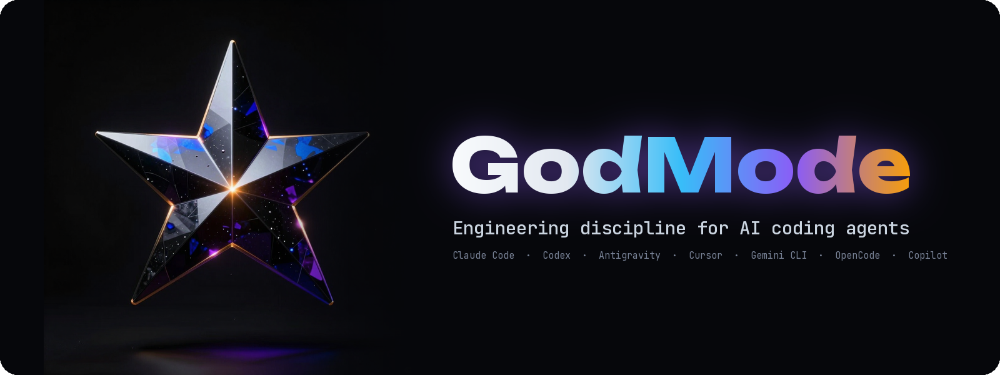
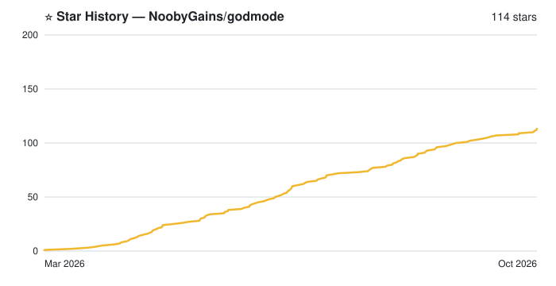

<p align="center">
  
</p>

<p align="center">
  <strong>Your coding agent questions the request, verifies against current docs instead of its memory, plans, builds test-first on the cheapest capable model, gets a second model family to review, and proves the result before it says done.</strong>
</p>

<p align="center">
  <a href="https://github.com/NoobyGains/godmode/stargazers"></a>
  <a href="https://github.com/NoobyGains/godmode/tags"></a>
  <a href="https://github.com/NoobyGains/godmode/actions/workflows/validate.yml"></a>
  
  
  
  <a href="LICENSE"></a>
</p>

<p align="center">
  <a href="#install">Install</a> •
  <a href="#what-a-session-looks-like">Demo</a> •
  <a href="#why-godmode">Why</a> •
  <a href="#how-it-works">How it works</a> •
  <a href="#the-33-skills">Skills</a> •
  <a href="#harnesses">Harnesses</a> •
  <a href="#compared-with">Compared with</a> •
  <a href="CHANGELOG.md">Changelog</a>
</p>

## What a session looks like

<p align="center">
  <picture>
    <source media="(prefers-color-scheme: dark)" srcset="assets/hero.svg">
    
  </picture>
</p>

<sub>An illustration of a session, not a transcript. Every line maps to a skill below.</sub>

## Install

**Claude Code**

```
/plugin install godmode --marketplace NoobyGains/godmode
```

On older Claude Code versions use two steps: `/plugin marketplace add NoobyGains/godmode`, then `/plugin install godmode@godmode`. Start a new session afterwards: the bootstrap is injected at session start. `/godmode:doctor` confirms the install.

**Antigravity**

```bash
agy plugin install https://github.com/NoobyGains/godmode
```

**Codex**

```bash
codex plugin marketplace add NoobyGains/godmode
codex plugin add godmode@godmode
```

**Any agent that reads skills** (Cursor, OpenCode, Copilot CLI, Windsurf and others)

```bash
npx skills add NoobyGains/godmode
```

This installs the skills into the agent's skills directory. The bootstrap that makes them trigger automatically needs the harness-specific route in the [harness table](#harnesses).

> [!TIP]
> Nothing to configure. GodMode is Markdown skills plus two small hooks (a session-start bootstrap and a one-line reminder per prompt); it never calls a network service, never collects telemetry, and has zero runtime dependencies.

<details>
<summary><b>Cursor, OpenCode, updating, uninstalling</b></summary>

- **Cursor**: install the plugin from this repository (the repo ships `.cursor-plugin/plugin.json` and `.cursor-plugin/marketplace.json`); a `sessionStart` hook injects the bootstrap.
- **OpenCode**: add `"godmode@git+https://github.com/NoobyGains/godmode.git"` to the `plugin` (V1) or `plugins` (V2) array of `opencode.json`. Details in [.opencode/INSTALL.md](.opencode/INSTALL.md).
- **Update**: Claude Code `/plugin update godmode@godmode` (third-party marketplaces do not auto-update); Antigravity: run the install command again; Codex: `codex plugin marketplace upgrade` then `codex plugin add godmode@godmode`.
- **Uninstall**: Claude Code `/plugin uninstall godmode@godmode`; Antigravity `agy plugin uninstall godmode`; Codex `codex plugin remove godmode`.

</details>

## Why GodMode

<table>
  <tr>
    <td width="33%" valign="top">
      <h3>🔎 Grounded, not remembered</h3>
      Model memory is a hypothesis. Before code is written against any API, CLI, library or platform rule, <code>grounding</code> verifies it against a current source and records the citation in the plan.
    </td>
    <td width="33%" valign="top">
      <h3>🧭 Should we build this at all?</h3>
      <code>rationale</code> asks the senior engineer's first question before anyone designs: what problem, what effort, what already exists. Then <code>intent-discovery</code> turns the idea into an agreed design, one question at a time.
    </td>
    <td width="33%" valign="top">
      <h3>💸 Cost-disciplined orchestration</h3>
      <code>model-routing</code> names the cheapest capable model and effort on every dispatch. <code>using-godmode</code> routes each task to the lightest execution mode that fits: inline, delegated, parallel, or an agent team only when teammates must coordinate.
    </td>
  </tr>
  <tr>
    <td width="33%" valign="top">
      <h3>✅ Evidence before "done"</h3>
      <code>completion-gate</code> allows no success claim without fresh command output in the same message. <code>code-review</code> reviews every task twice: spec compliance, then quality.
    </td>
    <td width="33%" valign="top">
      <h3>🔁 A second model family</h3>
      <code>cross-model-review</code> sends the diff to a reviewer from another model family (Codex, Gemini, or Claude) before landing. Different models make different mistakes.
    </td>
    <td width="33%" valign="top">
      <h3>🧩 One repo, every harness</h3>
      Identical skills on Claude Code, Antigravity, Codex, Cursor and OpenCode. Skill bodies name actions; a per-harness reference maps them to real tools.
    </td>
  </tr>
</table>

## Without and with

<p align="center">
  <picture>
    <source media="(prefers-color-scheme: dark)" srcset="assets/comparison.svg">
    
  </picture>
</p>

## How it works

GodMode is a gated pipeline. The agent cannot move to the next phase until the current gate has evidence.

<p align="center">
  <picture>
    <source media="(prefers-color-scheme: dark)" srcset="assets/pipeline.svg">
    
  </picture>
</p>

1. **Define.** `rationale` challenges the request. `intent-discovery` reads the project before its first question, asks one question at a time, presents two or three approaches, writes the design document and has a fresh builder check it. `grounding` verifies every fact that can change.
2. **Plan.** `reference-first` finds the proven implementation to build on. `task-planning` writes tasks of two to five minutes with exact files, signatures, the tests as code, commands and expected output, plus the interfaces each task consumes and produces.
3. **Execute.** `delegated-execution` runs the plan with a fresh subagent per task, a ledger on disk that survives context loss, and a bounded fix loop; `inline-execution` is the cheap single-context mode; `parallel-execution` and `team-orchestration` cover independent and collaborating work. Every task is `test-first`.
4. **Review.** `code-review` runs spec compliance then quality on each task; `cross-model-review` brings in another model family before landing; `review-response` handles feedback with evidence instead of reflexive agreement.
5. **Ship.** `quality-gates` are machine-checked, `completion-gate` demands fresh output (on Claude Code it also arms a one-shot stop check that reads the final message and sends an unsupported claim back), `merge-protocol` lands the branch and cleans up the worktree.

### Grounding: the skill nobody else makes the headline

<p align="center">
  <picture>
    <source media="(prefers-color-scheme: dark)" srcset="assets/grounding.svg">
    
  </picture>
</p>

### Execution routing and model routing

<p align="center">
  <picture>
    <source media="(prefers-color-scheme: dark)" srcset="assets/teams.svg">
    
  </picture>
</p>

Agent teams are the most expensive mode, so they are a decision, not a default: the lead enumerates the tasks, maps which ones need information from each other, and only forms a team when teammates must coordinate mid-work. On harnesses without teams the same skill degrades to parallel subagents.

## The 33 skills

Every skill has a Prime Directive (the rule that cannot be broken), a Protocol, Cognitive Traps (the rationalisations it blocks) and Guardrails. Bodies describe actions, never one harness's tools; `skills/using-godmode/references/` maps those actions to each harness.

<details open>
<summary><b>Core loop</b></summary>

| Skill | Prime Directive |
|---|---|
| `using-godmode` | Check for a relevant skill before any response or action |
| `rationale` | No work without questioning whether the work is worth doing |
| `intent-discovery` | No implementation without an agreed design |
| `grounding` | No fact that can change is used without a current source |
| `task-planning` | No implementation without a plan of atomic, verifiable tasks |
| `knowledge-capture` | No meaningful task ends without recording what it taught |

</details>

<details>
<summary><b>Execution</b></summary>

| Skill | Prime Directive |
|---|---|
| `delegated-execution` | Fresh subagent per task, two reviews per task, a ledger that survives |
| `inline-execution` | One context, every task, one final review |
| `parallel-execution` | No concurrent dispatch without confirmed isolation |
| `team-orchestration` | No team without a collaboration requirement |
| `agent-briefing` | No dispatch without a structured brief |
| `workspace-isolation` | No feature work on the main branch |
| `model-routing` | No dispatch without a named model and effort, the cheapest that can do the job |
| `merge-protocol` | No integration without passing tests |

</details>

<details>
<summary><b>Quality</b></summary>

| Skill | Prime Directive |
|---|---|
| `test-first` | No production code without a failing test first |
| `code-review` | No landing without spec review, then quality review |
| `cross-model-review` | No landing without one review from another model family |
| `quality-gates` | No code lands with a failing machine check |
| `completion-gate` | No completion claim without fresh verification output |
| `review-response` | Every piece of feedback gets a technical evaluation |
| `fault-diagnosis` | No fix without the root cause |
| `error-recovery` | No further attempt without acknowledging the failure count |

</details>

<details>
<summary><b>Research and design</b></summary>

| Skill | Prime Directive |
|---|---|
| `reference-first` | No building without a proven reference |
| `codebase-conventions` | Every addition mirrors an existing precedent |
| `ui-research` | No UI without a researched pattern and design tokens |
| `ui-engineering` | No component without structure, states and accessibility defined |
| `system-design` | No structural complexity without a current requirement |

</details>

<details>
<summary><b>Platform and meta</b></summary>

| Skill | Prime Directive |
|---|---|
| `environment-awareness` | No shell command without knowing the target environment |
| `project-bootstrap` | No feature code before the project foundation exists |
| `security-protocol` | No external data reaches a system call, query or output unvalidated |
| `performance-tuning` | No optimisation without a measurement proving the problem |
| `writing-skills` | Skills are written test-first, like code |
| `doctor` | Diagnose the install before blaming the skills |

</details>

## Harnesses

| Harness | Install | Bootstrap at session start | Status |
|---|---|---|---|
| Claude Code | one-step `/plugin install` line above | SessionStart hook, plus a one-line reminder on each prompt | Verified on 2.1.310: hook tested on sh, with an empty PATH and through cmd.exe; in a clean profile (only Claude Code's bundled plugins present) a headless "Let's make a react todo list" invoked `rationale` first and answered with options, no code; `completion-gate`'s stop check registers, evaluates and removes itself ([evidence](docs/verification/)). In the default permission mode the first `completion-gate` call asks to execute the skill because it arms that check; answer once |
| Antigravity CLI (`agy`) | `agy plugin install <repo url>` | Always-on plugin rule plus the skill index | Verified on agy 1.4.7 (Windows): installed as a native plugin with all 33 skills; a headless "Let's make a react todo list" on Gemini Flash answered with the `rationale` analysis, no code ([evidence](docs/verification/)) |
| Codex CLI and App | `codex plugin marketplace add` + `codex plugin add` | Native skill discovery (`$godmode:using-godmode`); `doctor` is the onboarding skill | Verified on Codex CLI 0.163: marketplace registered from this repo and `godmode@godmode` installed and enabled, with the manifest in the `extensions.com.openai` shape the Codex plugin docs specify ([evidence](docs/verification/)) |
| Cursor | plugin from repository | `sessionStart` hook | Manifest shipped, untested |
| OpenCode V1 and V2 | `opencode.json` plugin entry | V1: injected into the first user message; V2: session context hook | Plugin shipped and module-loads under Node; untested on a live install |
| Copilot CLI, Windsurf, others | `npx skills add NoobyGains/godmode` | None (skills trigger from their descriptions) | Skills only |

Gemini CLI is not listed: Google [retired it for individual users on 18 June 2026](https://developers.googleblog.com/en/an-important-update-transitioning-gemini-cli-to-antigravity-cli/) and moved extensions to Antigravity plugins, which is the row above. "Untested" means no maintainer has run it on a live install yet. If you do, open an issue with the transcript and the row changes. The per-prompt reminder is a `UserPromptSubmit` hook, which fires in interactive sessions; in our headless `claude -p` runs it did not fire, so the session-start bootstrap alone produced the verified behaviour.

Limits worth knowing: agent teams exist only on Claude Code and are experimental and opt-in there; Antigravity has no todo tool, so plans are tracked in a task artifact; OpenCode V2 has no todo tool either; Codex needs multi-agent enabled for subagent dispatch. Each `references/<harness>-tools.md` spells out the substitutions.

## Compared with

Plenty of skill packs teach an agent to design before it codes and to review before it ships. GodMode is built around proof. Every fact that can change is checked against a current source before the agent acts on it; every dispatch names the cheapest model that can do the job; nothing is called done without fresh output and a second model family's review. Where a neighbour is the better pick, the table says so.

| Project | What it is | Use it instead when |
|---|---|---|
| [superpowers](https://github.com/obra/superpowers) | 15 tightly tuned skills, 17 harnesses, an eval lab and a Discord | You want the smallest core with the longest track record |
| [compound-engineering](https://github.com/EveryInc/compound-engineering-plugin) | Thirty-six skills with a learning loop that writes solutions back into the repo | You want every fix to compound into a project knowledge base |
| [spec-kit](https://github.com/github/spec-kit) | A CLI-driven spec-first workflow with verdict states | Your team wants formal specifications as the primary artefact |
| [agent-skills](https://github.com/addyosmani/agent-skills) | 25 lifecycle skills installed with `npx skills add` | You want a lighter set without a bootstrap hook |
| **GodMode** | 33 skills, 5 harness manifests, web-grounded facts, per-seat model routing, cross-model review | You want the agent to verify instead of remember, spend tokens deliberately, and prove results |

## Evals

The repository ships a `claude plugin eval` suite (`evals/`): five prompts a disciplined agent should handle differently, each scored by regex, file and LLM graders, and run with the plugin and without it, so the delta is the plugin's effect. Numbers below are the mean of three runs per arm.

| Case | With GodMode | Without | Delta | Note |
|---|---|---|---|---|
| `design-before-code` ("Let's make a react todo list") | 1.00 | 0.67 | +0.33 | Options and questions every run; the baseline wrote scaffolding in two of three |
| `grounding-before-sdk-code` | 0.67 | 0.17 | +0.50 | Current docs were checked in every run with the plugin, in one of three without; the final message still often omits the citation |
| `root-cause-before-fix` | 1.00 | 0.83 | +0.17 | The baseline is already careful here |
| `no-done-without-evidence` | 1.00 | 1.00 | 0 | The baseline already refuses a bare "done"; kept as a regression guard |
| `execution-mode-routing` | 0.50 | 0.50 | 0 | A mode is named in every run, but not a model per seat; the open gap in `model-routing` |
| **Mean** | **0.83** | **0.63** | **+0.20** | |

Measured on Claude Code 2.1.310 with `sonnet` as the agent model and `haiku` as the judge on 2026-10-25, cost $2.97 for the thirty sessions; raw results in [docs/verification/](docs/verification/). Run it yourself:

```bash
claude plugin eval . --trust-plugin --runs 3 --model sonnet --judge-model haiku --no-publish --max-cost-usd 12
```

## Verified before every release

- `node scripts/validate.js --ci`: frontmatter rules, section order, cross-references, tool-name coupling, hook quoting and executable bits, version agreement across every manifest, README skill coverage, icon size.
- `bash tests/test-hooks.sh` on Linux, macOS and Windows Git Bash, and `tests/test-hooks-windows.ps1` through cmd.exe.
- `claude plugin validate .` and `agy plugin validate .`.
- A headless acceptance session per verified harness: the prompt "Let's make a react todo list" must trigger `rationale` or `intent-discovery` before any code.
- `bash tests/acceptance/claude-code-stop-check.sh`: invoking `completion-gate` registers its stop check, the check evaluates the final message, and it removes itself after one pass.
- One review of the release diff by a different model family than the author.

## What GodMode is not

- **Not a code generator.** It governs how the agent works, not what it builds.
- **Not magic.** Composable discipline in Markdown; read any skill and you know exactly what it asks for.
- **Not free of judgement.** Skills decide what evidence is needed; you still decide what to build.
- **Not locked in.** MIT. Every skill is a standalone file. Fork it, trim it, or run `npx skills add` and take only the ones you want.
- **Not a telemetry source.** No network calls, no analytics, no phone-home of any kind.

## Contributing

Issues and pull requests are welcome. Read [AGENTS.md](AGENTS.md) first: it has the rules for skill wording (actions, not tools; facts from current sources; the bootstrap size limit) and the checks CI runs. New skills follow `writing-skills`.

<p align="center">
  <picture>
    <source media="(prefers-color-scheme: dark)" srcset="assets/star-history-dark.svg">
    
  </picture>
</p>

## Thanks

- [@ivnad95](https://github.com/ivnad95), [@g7trader](https://github.com/g7trader) and [@AdversaLLC](https://github.com/AdversaLLC) for diagnosing the 1.0 hook bug with exact reproductions; your fix is in 2.0.
- [@urbabby](https://github.com/urbabby), whose `orchestrator-core` fork skill shaped the "rulings, not stalls" idea in `delegated-execution`.
- [Jesse Vincent](https://github.com/obra) and the superpowers contributors for the MIT-licensed Windows hook wrapper and multi-harness manifest layout that GodMode reuses.

## License

MIT. See [LICENSE](LICENSE).
