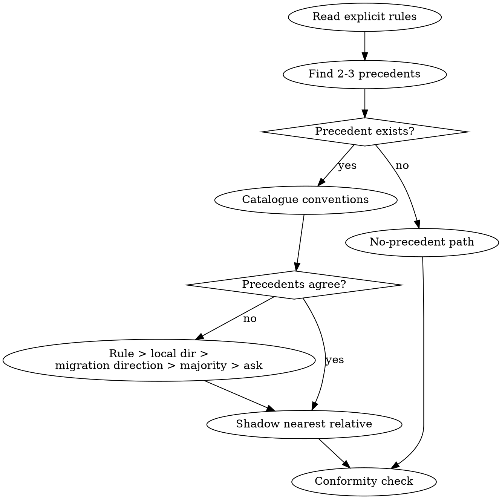

# Codebase Conventions

An existing codebase is the most authoritative reference for how new code in it should look. Before adding anything, find the two or three closest precedents, write down the conventions they share, build the new code by shadowing the nearest one, and check the result against them before committing. **New code must read as if the original authors wrote it: one way of doing each thing, not two.**

## The Prime Directive

```
NO NEW CODE WITHOUT A NAMED PRECEDENT IN THIS REPOSITORY
```

No exceptions. No workarounds. No shortcuts.

If you cannot point to the file you modelled your change on, you guessed. When no precedent exists, say so, and establish the convention deliberately.

## When to Use

**Required:**
- Creating a file, module, route, component, service, job, migration or test in an existing project.
- Adding error handling, logging, validation, configuration or data access.
- Adding a dependency, or reaching for a library to do something the project may already do.
- Working in a repository, or a part of one, that you have not surveyed in this session.
- Refactoring code into a new shape.

**Skip:**
- A new project with no code yet: use `godmode:project-bootstrap`.
- Throwaway scripts that never enter version control.
- A change confined to lines you have just surveyed for the same task.

## The Protocol

1. **Read the explicit rules first.** Linter and formatter configs, `.editorconfig`, type-checker settings, `CONTRIBUTING`, `AGENTS.md` or similar agent instructions, architecture notes, ADRs. Explicit rules beat inferred ones. Note any check you will have to pass.

2. **Survey two or three precedents.** Find the files most similar to what you will add: same kind of thing (another route, another service, another form), same layer, ideally recent. Search by name, by directory, and by the pattern itself (the function you will call, the decorator you will use). Read them fully, plus their tests.

3. **Catalogue the conventions.** Fill in the table below from what the precedents actually do, quoting the file and line for each row. Leave a row empty rather than guessing.

4. **Resolve conflicts between precedents.** If two precedents disagree, decide in this order: an explicit rule (lint, docs) wins; then the convention in the directory you are editing; then the newer pattern if `git log` shows a migration towards it; then the majority. If it is still unclear, ask the user one question with both options and a recommendation.

5. **Pick the nearest relative and shadow it.** Use the closest precedent as a skeleton: same file placement, same section order, same imports and helpers, same error and logging calls. Change only what is specific to the new feature.

6. **Reuse before you add.** Before writing a helper, search for an existing one (`utils`, `lib`, `common`, `shared`, base classes, hooks). Before adding a dependency, check the manifest and lockfile for something that already does the job. A new dependency that duplicates an existing one needs the user's approval.

7. **Run the conformity check** below on your diff before committing. Fix every miss or write down why it differs.

8. **Leave evidence.** In the task report or commit message, name the precedent you shadowed ("modelled on `src/billing/invoice.service.ts`") and any convention you established for the first time.



## The Convention Catalogue

Write this down (in your notes, the plan, or the brief you give a subagent) before writing code.

| Dimension | Question | Example answer |
|---|---|---|
| Placement | Where do siblings of this file live? By feature or by layer? | `src/<feature>/<feature>.service.ts` |
| File naming | Case and suffix pattern? | `kebab-case.ts`, `PascalCase.tsx`, `snake_case.py` |
| Exports | Default or named? Barrel files? | Named exports, re-exported from `index.ts` |
| Identifiers | Case for variables, functions, types, constants? Domain vocabulary? | `camelCase`, types `PascalCase`, "customer" not "user" |
| Function shape | Object parameter or positional? Sync or async? Return type? | `async fn({ id, tx })` returning `Result<T, AppError>` |
| Errors | Throw, return a result, error codes? Which error classes? | Throws `DomainError` subclasses; mapped in middleware |
| Validation | Where and with what? | Schema validation at the HTTP boundary only |
| Logging | Which logger, what fields, which levels? | `logger.info({ orderId }, "order.created")` |
| Data access | ORM, query builder, repository layer, raw SQL? Transactions how? | Repository functions take a `tx` argument |
| Configuration | How are settings and secrets read? | Typed `config` module, never `process.env` inline |
| State (UI) | Local, context, store, server-state library? | Server state through the existing query library |
| Styling (UI) | Utility classes, CSS modules, CSS-in-JS, design-system props? | See `godmode:ui-engineering` |
| Tests | Framework, location, naming, fixtures, what is mocked? | Co-located `*.test.ts`, factories in `test/factories` |
| Comments and docs | Docstring style and density? | Public functions get a one-line docstring |
| Commits | Message format? | Conventional Commits |

## Typical Drift

The divergences agents introduce most often, and what to do instead.

| Drift | Instead |
|---|---|
| `console.log` or `print` in a project with a structured logger | Use the project's logger and its field conventions |
| Generic `try/catch` with a string error | Use the project's error hierarchy or result type |
| A second HTTP client (`axios` next to a `fetch` wrapper) | Use the existing wrapper |
| A new helper that duplicates one in `utils/` | Search first; extend the existing helper if needed |
| Default exports in a named-export codebase | Match the export style |
| Loose types (`any`, untyped dicts) in a strict codebase | Match the type discipline |
| Raw SQL beside an ORM, or the reverse | Use the established data-access layer |
| A new folder layout for "your" feature | Place it where its siblings live |
| Tests in a different framework or style | Copy the nearest test file's structure |
| Inline styles or arbitrary values beside a design system | Use the system's tokens and components |

## When No Precedent Exists

1. **Confirm the absence.** Search at least three ways (by name, by directory, by the pattern or API you would call). In a monorepo, check sibling packages.
2. **Look outside.** Invoke `godmode:reference-first` for an external reference that fits the project's stack.
3. **Stay in character.** Make the new convention consistent with the spirit of the codebase: its naming, its error style, its layering.
4. **Make it explicit.** Tell the user a new convention is being introduced and why, in one or two sentences, before you build on it.
5. **Write it down.** Record the new convention where the project keeps such notes (contributing guide, agent instructions, ADR) so the next change finds a precedent. `godmode:knowledge-capture` covers where.

## When the Convention Looks Wrong

Follow it anyway, and raise it separately. Mixing a better pattern into one file leaves the codebase with two patterns, which is worse than one imperfect pattern. If the existing convention causes a real defect (a security hole, data loss), stop and tell the user; that is a bug, not a style question. A migration to a new pattern is its own task with the user's approval.

## Pre-Commit Conformity Check

Hold the diff next to the precedent you shadowed and confirm:

- [ ] Every new file sits beside its siblings and follows the file-naming pattern.
- [ ] Imports use the same aliases, order and barrel files.
- [ ] Identifiers use the project's casing and domain vocabulary.
- [ ] Errors, logging and validation use the project's mechanisms, not new ones.
- [ ] No new dependency duplicates an existing one; any new dependency was approved.
- [ ] No helper duplicates an existing helper.
- [ ] Tests follow the existing framework, location, naming and fixture style.
- [ ] The project's own lint, format and type checks pass on the changed files (run them; do not assume).
- [ ] A reviewer could not tell which lines are new by style alone.

## Cognitive Traps

| Rationalisation | Truth |
|---|---|
| "My approach is cleaner." | Two patterns are worse than one adequate pattern. Consistency is the feature. |
| "This is a new module, so its conventions are mine." | New modules live in the old project and are read by the same people. |
| "The pattern is outdated." | Outdated and consistent beats modern and forked. Propose a migration as a separate task. |
| "It is one small helper." | Small helpers are the most reused code. A wrong pattern spreads from them. |
| "I read one similar file." | One file can be the exception. Two or three show the rule. |
| "I will tidy it to match later." | Later rarely comes, and partial migrations are the worst state. |
| "This library is better than the one they use." | Better in isolation does not justify a second library for the same job. |
| "There is no precedent." | Search three ways first, including the sibling packages and the tests. |

## Guardrails

**Never:**
- Add a dependency that overlaps one already in the project without the user's approval.
- Introduce a second way of doing errors, logging, validation, configuration or data access.
- Change an established convention in passing while doing other work.
- Skip the project's own lint, format and type checks before committing.

**Always:**
- Read the explicit rules (lint config, contributing guide, agent instructions) first.
- Survey two or three precedents and catalogue their conventions before writing.
- Name the precedent you shadowed in the report or commit message.
- Include the convention catalogue in any brief for a subagent that will write code here.
- Tell the user when you establish a convention for the first time.

## Connections

- `godmode:reference-first`: routes in-repository work here, and is where to go when no internal precedent exists.
- `godmode:project-bootstrap`: for new projects with no code to survey.
- `godmode:ui-engineering`: applies the same discipline to the project's design system.
- `godmode:task-planning`: plan tasks name the precedent file for each change.
- `godmode:test-first`: new tests follow the test conventions catalogued here.
- `godmode:code-review`: reviewers check conformity against the precedent named in the report.
- `godmode:knowledge-capture`: records a newly established convention so the next change finds it.
