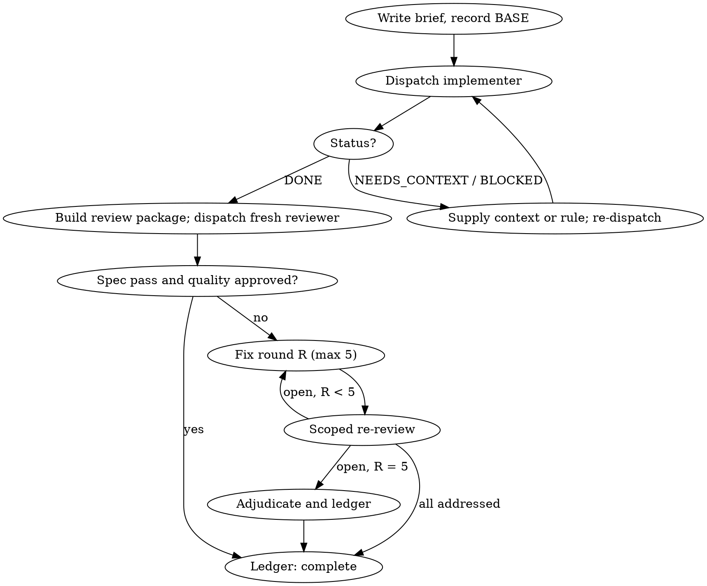

# Delegated Execution

Execute a plan by giving each task to a fresh implementer subagent, reviewing each task with a fresh reviewer, and closing with one review of the whole branch. You are the controller: you prepare briefs, dispatch, read short reports, rule on conflicts, and keep the ledger. You do not write the code.

**Core principle: the ledger on disk is the memory, the brief is the requirement, the report file is the evidence, and a fresh reviewer is the gate.** Your own recollection is none of these; after a context compaction it is the least reliable thing in the session.

## The Prime Directive

```
NO TASK IS COMPLETE UNTIL A FRESH REVIEWER PASSES IT AND THE LEDGER SAYS SO
```

No exceptions. No workarounds. No shortcuts.

## When to Use

**Required:**
- A plan from `godmode:task-planning` exists, with numbered tasks.
- The tasks are mostly independent: each can be built and reviewed on its own surface.
- The harness can dispatch subagents.
- The work is long or risky enough that a review per task pays for itself.

**Skip:**
- No subagents on this harness, or the user chose the cheap mode: use `godmode:inline-execution`.
- Several unrelated problems that need no shared plan: use `godmode:parallel-execution`.
- Workers must talk to each other mid-task: use `godmode:team-orchestration`.
- No plan yet: go back to `godmode:task-planning`.

## Operating Rules

**Run continuously.** Do not pause between tasks to ask whether to continue. The user asked for the plan to be executed; progress summaries mid-run cost their time and buy nothing.

**Rulings, not stalls.** When the plan conflicts with itself or the spec, a reviewer's finding contradicts the plan text, or a brief is ambiguous, decide. The spec is the binding authority, the plan is its argument, and your judgment settles what neither answers. Write every decision to the ledger as:

```
Ruling: <what you decided> / <why> / <cost if wrong>
```

Then keep going. A wrong ruling costs rework the user can see and undo; a session parked on a question costs their whole day.

**Four things stop you, and only these:** an irreversible or destructive action; a security-sensitive action (credentials, permissions, production data); a side effect outside this workspace that norms say you ask about first (a merge, a push to a shared branch, a publish); a plan so broken that every path forward is a guess. For those, stop and ask the user one clear question.

**Hand over files, not pastes.** Everything you paste into a dispatch and everything a subagent prints back stays in your context for the rest of the session. Briefs, reports and diffs travel as file paths.

## The Protocol

1. **Isolate.** Invoke `godmode:workspace-isolation` to create or confirm a worktree on a feature branch. Never implement on the trunk branch without the user's explicit consent.

2. **Open the plan workspace and ledger.** Each plan owns a git-ignored directory, `.godmode/runs/<plan-slug>/`, holding its ledger, briefs, reports and review packages. If the `godmode` helper is on your PATH (`command -v godmode`), use it for the workspace, briefs, review packages and ledger lines; otherwise the equivalent shell commands and the exact line formats are in [references/ledger-and-workspace.md](references/ledger-and-workspace.md). If `progress.md` exists and its first line names this plan, resume: every task with a `complete` line is done and is never re-dispatched; a task whose last line is a fix round resumes at the next round. If the first line names another plan, that is someone else's progress; use a separate directory. After compaction, trust the ledger and `git log` over memory.

3. **Read the plan once, and the spec if it names one.** Note the global constraints. No reachable spec gets a ledger line saying rulings are provisional. Create one task-tracker item per plan task.

4. **Pre-flight scan.** Before Task 1, write a table to the ledger: one row for every pair of tasks that share a file or an interface (what one produces, what the other consumes, what you found), and one row per task checking that its own text agrees with itself. Rule on every conflict before execution starts. "The scan is clean" without rows is not a scan.

5. **Group same-shape mechanical tasks.** When several tasks are each a small edit of the same kind (the same field added to six files, one constant renamed everywhere), write one brief listing every file and its change, dispatch it to one implementer, and review the batch as one unit. Keep one dispatch per task for work that needs its own judgment, tests or review surface.

6. **Run the task loop** (next section) for each task or batch, in plan order, one implementer at a time. Parallel implementers on one branch collide.

7. **Final whole-branch review.** Build a review package from the branch's merge base to `HEAD` and dispatch one reviewer on a top-tier model with [reviewer-prompt.md](reviewer-prompt.md) in whole-branch mode, the plan and spec paths, and the ledger's deferred-minor and parked lines. If it returns Critical or Important findings, dispatch ONE fix implementer with the complete list, then exactly one scoped re-review with [re-review-prompt.md](re-review-prompt.md). Adjudicate residuals as at the breaker. There is no second fix wave.

8. **Report and hand off.** Your final message lists every ledger `Ruling:` line in order under "Rulings I made", every deferred minor under "Deferred minors", and the ledger's cost lines summed per seat. Then invoke `godmode:merge-protocol`. Delete the plan workspace only after the work has landed or the user chose to keep the branch; sibling plan directories are never yours.

## The Task Loop



**a. Brief.** Record `BASE` with `git rev-parse HEAD`. Extract the task's full text from the plan into `task-<N>-brief.md` (command in the reference). The implementer reads the brief, never the whole plan. Exact values (numbers, strings, signatures, test cases) live only in the brief; do not retype them in the dispatch.

**b. Dispatch the implementer** with [implementer-prompt.md](implementer-prompt.md), naming model and effort per `godmode:model-routing`. The dispatch carries: one line on where the task fits; the brief path; interfaces and decisions from earlier tasks the brief cannot know; your ruling on any ambiguity you saw; pointers to parked findings in the area; the report path `task-<N>-report.md`. It never carries the session's history. Record the implementer's identity in the ledger, because fix rounds 1-3 resume it.

**c. Handle the status.**
- `DONE`: go to review.
- `DONE_WITH_CONCERNS`: read the concerns. Correctness or scope doubts are resolved before review; observations are noted and review proceeds.
- `NEEDS_CONTEXT`: supply what is missing and re-dispatch on the same model.
- `BLOCKED`: change something. More context on the same model, a more capable model, a smaller task, or a ruling that corrects the plan. Never re-dispatch the same request to the same model unchanged.

**d. Review.** Write the review package for `BASE..HEAD` to a file (never `HEAD~1`, which drops all but the last commit of a multi-commit task). Dispatch a fresh reviewer with [reviewer-prompt.md](reviewer-prompt.md): the brief, the report file, the package, and the plan's global constraints copied verbatim. The reviewer returns two verdicts in order: spec compliance, then quality. Both are required. Do not pre-judge: if your dispatch contains "do not flag" or "at most Minor", delete it and let the finding come. "Cannot verify from diff" items are yours to resolve with the cross-task context you hold; a confirmed gap counts as a failed spec review.

**e. Fix loop.** It triggers on a spec failure, any Critical or Important finding, or a confirmed gap. Minor findings never enter it; ledger them as deferred minors. A finding that contradicts the plan text is ruled on first and ledgered. One round is one fix dispatch plus one scoped re-review:
- **Rounds 1-3:** resume the original implementer with the open findings verbatim. If the harness cannot message a finished subagent, dispatch a fresh one with the brief, the report file and the findings; the report file carries the memory.
- **Rounds 4-5:** a fresh implementer on a model at least one tier up, told "A prior implementer attempted this task R times; you own it now. Read the report file for what was tried."
- Each round the implementer appends a fix report (covering tests, command, output) to the same report file. Confirm all three are present, then dispatch the scoped re-review over `FIX_BASE..HEAD`, where `FIX_BASE` is the head the previous review saw.
- Ledger every round: `Task <N>: fix round <R>/5 (<X> addressed, <Y> open; commits <a>..<b>)`.
- **The breaker.** After round 5, stop dispatching and adjudicate each open finding: wrong or contestable, park with a ruling; real but nothing builds on it, park with a ruling; real and load-bearing, rule on the smallest unblocking change and carry it into the next dispatch. Adjudicating before the cap is pre-judging under another name.

**f. Complete.** Append `Task <N>: complete (commits <base>..<head>, review clean)` or `(..., <K> parked)`, plus the task's cost line, in the same step as your other bookkeeping. Mark the tracker item done. Never move on while a Critical or Important finding is neither fixed nor parked with a ruling.

**Waiting.** While subagents run, do local bookkeeping. When idle, wait in bounded stretches of a few minutes, and between stretches check which children finished without reporting. Never poll in tight loops; never wait silently forever.

## Cognitive Traps

| Rationalisation | Truth |
|---|---|
| "I remember which tasks are done" | Compaction erases that. Controllers without a ledger have re-dispatched whole completed sequences. Read the ledger. |
| "Close enough on spec compliance" | A spec gap means not done. The exits are a pass or the breaker, nothing else. |
| "Quicker if I fix it myself" | Controller fixes skip review and fill your context. Resume the implementer. |
| "This finding is obviously wrong, drop it" | You adjudicate only at the cap, and every adjudication is a ledger line. Silent discards are forbidden. |
| "The fix was one line, skip the re-review" | Unreviewed fixes are how regressions land. Every round ends with a scoped re-review. |
| "One more round will converge" | Past five, the failure is structural. Adjudicate and route. |
| "I'll ask the user which way to go" | Unless it is one of the four stops, rule, ledger it, and continue. |
| "Paste the diff into the reviewer prompt" | It stays in your context forever. Write it to a file and pass the path. |
| "Same model for every seat keeps it simple" | An unnamed model inherits the session's, usually the most expensive. Name it every time. |

## Guardrails

**Never:**
- Implement on the trunk branch without explicit consent.
- Skip either review verdict, or run quality before spec compliance.
- Dispatch two implementers on the same branch at once.
- Make a subagent read the whole plan, or paste accumulated history into a dispatch.
- Let an implementer or reviewer dispatch its own subagents; every review seat is already scheduled.
- Re-dispatch a task the ledger marks complete.
- Delete the plan workspace before the rulings are reported.

**Always:**
- Name model and effort on every dispatch.
- Record `BASE` before dispatch and build every review package from a recorded commit.
- Write a ledger line for every ruling, round, completion, deferred minor and parked finding.
- Run the final whole-branch review on a top-tier model before hand-off.
- Report every ruling to the user before cleanup.

## Connections

- `godmode:task-planning`: produces the plan this skill executes.
- `godmode:workspace-isolation`: before Task 1, for the worktree and a clean baseline.
- `godmode:agent-briefing`: the brief and report formats every dispatch here uses.
- `godmode:model-routing`: which model and effort each seat gets, and the escalation ladder.
- `godmode:test-first`: implementers follow it inside every task.
- `godmode:code-review`: the review method the reviewer prompt applies.
- `godmode:cross-model-review`: after the final review, when the user wants a second model family before landing.
- `godmode:inline-execution`: the cheaper mode; it shares this workspace and ledger format, so a run can switch modes mid-plan.
- `godmode:merge-protocol`: the hand-off once the final review is clean.
