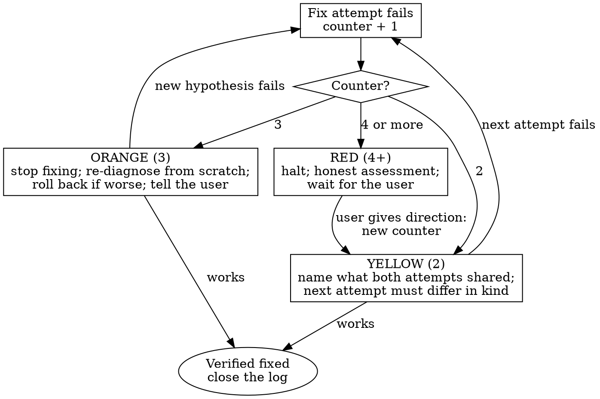

# Error Recovery

Agents get stuck in a recognisable way: the same approach, retried with small variations, each attempt adding code and confidence but not progress. This skill counts the attempts, escalates at fixed thresholds and forces either a genuinely different approach, a rollback, or an honest report to the user. **Retries are bounded; the counter decides when to stop, not your optimism.**

## The Prime Directive

```
EVERY ATTEMPT IS COUNTED, AND AFTER THE THIRD FAILURE YOU STOP AND TELL THE USER
```

No exceptions. No workarounds. No shortcuts.

## When to Use

**Required, as soon as any of these is true:**
- The same error, or the same failing test, survives two fix attempts.
- A fix for one problem produces a new problem.
- The same file has been edited three or more times for one issue.
- Each attempt makes the code longer or more complex and the problem is not smaller.
- The test suite has more failures than when you started.
- You are reverting a change and trying a variation of it.
- You hear yourself think "let me try one more thing".

This skill overrides whatever strategy is currently failing.

**Skip:**
- The first failure of a fix. That is ordinary diagnosis; stay in `godmode:fault-diagnosis` and keep the counter.

## The Protocol

1. **Open a failure log** for the issue the moment the first fix fails, and keep it in the task notes or the progress ledger so it survives a context reset:

   ```
   Issue: checkout total is off by one cent for some carts
   Attempt 1: rounded each line item to 2 decimals -> 3 carts still wrong
   Attempt 2: rounded the total instead of lines -> different 2 carts wrong
   Attempt 3: ...
   ```

2. **Count every attempt.** A small tweak counts. A variation of the same idea counts. Reverting and retrying counts. A new error that appeared while fixing this one belongs to the same issue and the same counter. The counter resets only when the issue is verified fixed or the user redefines the problem.

3. **Before each attempt, say its number.** "This is attempt 3 for the checkout rounding issue." Saying it out loud is what keeps the counter honest.

4. **Escalate by the ladder below.** The level is set by the counter, not by how close the last attempt felt.

5. **On recovery, verify and close.** When an attempt works, prove it with `godmode:completion-gate` (the regression test, the full suite, the original reproduction), record the attempt that worked and why the others did not, and close the log.

## The Severity Ladder



### Yellow: two failed attempts

- Say it: "Two attempts have failed for this issue."
- Write down what the two attempts had in common: the same file, the same layer, the same assumption, the same kind of change.
- The next attempt must be **fundamentally different**, not a variation (see the table below). If you cannot name a different approach, go straight to orange.

### Orange: three failed attempts

- **Stop making fixes.**
- Re-read the original error and the original requirement from scratch, as if for the first time.
- Write three lists: what you know (with evidence), what you assumed, what you have not verified. The bug is usually in the second or third list.
- If the code is now worse than when you started (more failures, more complexity), roll back to the last known-good state before going further (see below).
- Go back through phases 1 to 3 of `godmode:fault-diagnosis` with a hypothesis that contradicts at least one of your earlier assumptions.
- Tell the user where you are: "Three attempts have failed. Here is what I tried, what I now think is going on, and what I will try next." At orange you may make one more attempt on the new hypothesis while the user reads; at red you may not.

### Red: four or more failed attempts

- **Halt. No further attempts without the user's direction.**
- Give an honest assessment, in this shape:
  1. What the problem is, in one sentence.
  2. Every attempt, one line each, and what each one taught you.
  3. What you now believe the real cause is, and how sure you are.
  4. Options, with your recommendation: a different design, more information from the user, a smaller scope, help from someone with access you lack, or stopping. "I may not be able to solve this in this environment" is an acceptable option when it is true.
- Wait. When the user gives a direction, start a new counter for that direction.

## Fundamentally Different, Not a Variation

| If every attempt so far... | ...a different approach is |
|---|---|
| Edited configuration | Read and change the code that consumes the configuration |
| Patched the place the error appears | Trace the bad value to its source (`godmode:fault-diagnosis`) |
| Added code (guards, special cases, retries) | Remove code: simplify until the bug has nowhere to hide |
| Worked on the whole system | Build the smallest reproduction outside the system |
| Trusted what you believe is running | Prove it: print the version, the path of the file actually loaded, the function actually called |
| Followed one library's approach | Read that library's current documentation and issue tracker (`godmode:grounding`) or try the standard approach |
| Assumed the test is right | Check the test's assumptions; or, if you assumed the test is wrong, assume it is right |

## Rolling Back

When attempts have made things worse, go back to the last state you know was good and start from there with what you learned.

1. Find the last known-good commit (`git log`, the last green CI run, the last checkpoint in the progress ledger).
2. Save the failed work where it cannot be lost and will not land: a branch named for the attempt, or a stash with a message. Look at what is uncommitted before you discard anything.
3. Return to the good state on your working branch (`git switch` to it, or `git revert` the failed commits on a shared branch). Do not rewrite shared history or run destructive commands without the user's agreement.
4. Confirm the good state really is good: run the reproduction and the suite.
5. Apply the new approach from there, one step at a time.

## Cognitive Traps

| Rationalisation | Truth |
|---|---|
| "This is a different issue." | It appeared while you were fixing the first one. Same issue, same counter. |
| "I almost had it last time." | Two near-misses are a pattern, not progress. |
| "The approach is right; it just needs tweaking." | Three tweaks of one approach are one approach that has failed three times. |
| "One more log line will show it." | If three did not, you are logging in the wrong place. Change where you look. |
| "It must be a cache or an environment issue." | Prove it with a clean run before you act on it. |
| "Telling the user I am stuck looks bad." | Burning the user's time and money in a silent loop looks worse, and is. |
| "Let me refactor first and then fix it." | Refactoring while debugging turns one problem into two. |
| "The test must be wrong." | Usually the test is telling you the truth. Check its assumptions before you change it. |

## Guardrails

**Never:**
- Make an attempt without stating its number.
- Reset the counter by renaming the problem.
- Continue past the third failure without telling the user, or past the fourth without the user's direction.
- Suppress errors, skip tests or weaken assertions to make the failure go away.
- Discard failed work, rewrite shared history or run destructive commands without looking first and without the user's agreement.
- Report "almost working" as progress.

**Always:**
- Keep the failure log where it survives a context reset.
- Make the attempt after yellow different in kind, not in degree.
- Roll back when the code has become worse than the starting point.
- Give the user an honest, specific assessment at red, including "I do not know".
- Verify the eventual fix with fresh evidence before closing the log.

## Connections

- `godmode:fault-diagnosis`: the four phases you return to at orange; it hands over to this skill after three failed fixes.
- `godmode:completion-gate`: proves the fix that finally worked.
- `godmode:test-first`: the regression test that pins the fix.
- `godmode:grounding`: current documentation and issue trackers when the stuck point is a library or platform.
- `godmode:task-planning`: when recovery shows the task was scoped or designed wrong, re-plan before continuing.
- `godmode:workspace-isolation`: keeping failed attempts on their own branch or worktree so rollback is cheap.
