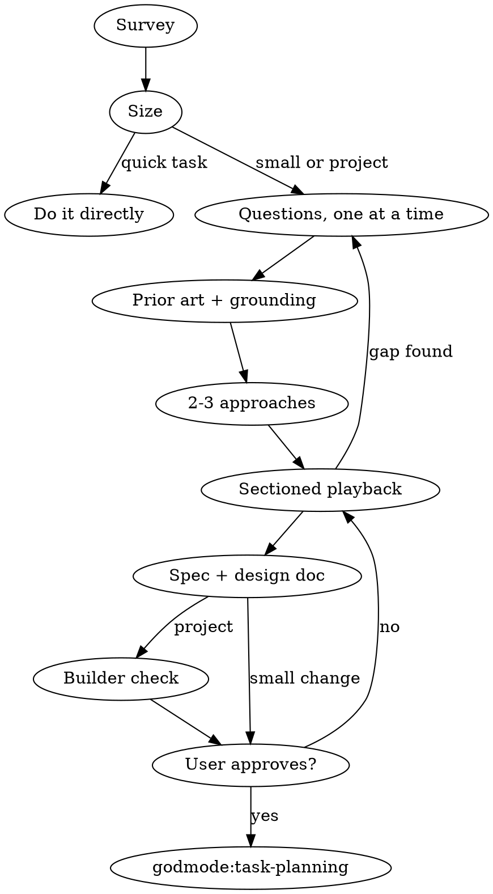

# Intent Discovery

Turn a request into a design the user has approved, with a specification precise enough that a capable builder could plan from it without asking again. You build what you believe the user wants, and that belief is usually thinner than it feels. **Find out what they want and why, one question at a time, and get sign-off on a written design before anything is built.**

## The Prime Directive

```
NOTHING GETS BUILT UNTIL THE USER APPROVES THE DESIGN
```

No exceptions. No workarounds. No shortcuts.

Building includes writing product code, scaffolding, installing dependencies, creating projects and invoking any implementation skill. Reading and exploring are fine.

## When to Use

**Required:**
- A new feature, component, page, endpoint, module or project.
- A change to how existing behaviour works.
- A redesign or re-architecture.
- The user picked option A or B in `godmode:rationale`.

**Skip:**
- A typo, a dictated config value, a rename the user specified exactly.
- A command the user gave verbatim.
- A bug: use `godmode:fault-diagnosis`.
- The user says to skip the questions. Then state any significant choice you are making (platform, language, storage) in one plain line and proceed through the normal pipeline.

## The Protocol

Create one task per step and track them.

1. **Survey the ground.** Read the relevant files, docs and recent commits. Note what exists, what conventions hold, and what the user has already decided. Evidence: a short list of what you found.
2. **Size the work.** Say the size in plain words; the user may override it.

   | Size | Design lives in | Next |
   |---|---|---|
   | Quick, clear task | the request itself | do it directly |
   | Small change | a design summary in chat | `godmode:task-planning` or direct work |
   | Project | `docs/plans/YYYY-MM-DD-<topic>-design.md` | `godmode:task-planning` |

   If the request is really several independent projects, say so, agree an order, and run this skill on one at a time.
3. **Ask, one question per message, starting from what you already know.** When the user has said what they want (a detailed request, a spec, a plan), open by echoing it back in your own words in about 200 words: what they want, who it is for and why, plus what the survey found that bears on it (how the relevant parts work today, what the change touches, any constraint, conflict or cheaper path they may not have seen). Invite corrections, then ask the one question whose answer would most change what gets built. When they have not said much, ask one open question in their own terms about the biggest thing the request leaves unsettled, and say what the answer would change. Build each later question on their last answer or on something you found. Cover purpose, users, success, constraints, non-goals and what they already have, but never ask what the project or the conversation already answers. Offer a short menu only when the user is stuck; a guess they can correct often beats a question. Stop asking when another answer would not change the design. If this skill started on its own rather than at the user's request, end the first message with a one-line offer to just get going instead; if they take it, state any significant choice you are making in one line and proceed.
4. **Look for prior art.** Invoke `godmode:reference-first` for proven implementations and `godmode:codebase-conventions` for in-repo precedent. Invoke `godmode:grounding` for every library, API, version or platform rule the design will rest on. Evidence: the sources you will build on, with links.
5. **Propose 2-3 approaches.** Label them A, B, C, lead with your recommendation, and give each its trade-offs in two or three lines. Cite the references that inspired each. The user chooses; never auto-pick.
6. **Play the design back in sections.** Describe each part (what it is for, how it behaves, what it touches) in up to 200-300 words, mark your own guesses as guesses, and ask what is wrong or missing before the next section. Cover architecture, components, data flow, error handling and testing.
7. **Write the specification section** (template below), scaled to the work.
8. **Write the design document** to `docs/plans/YYYY-MM-DD-<topic>-design.md` and commit it. For a small change, the chat summary is the design.
9. **Check it as the builder would** (projects only; a small change goes straight to the user). Tell the user a reviewer reads the document first and you may come back once with questions. Dispatch a fresh subagent with [the builder-check prompt](references/builder-check-prompt.md) and the document path, or read the document in that role yourself when dispatch is unavailable. Sort what comes back into three piles: answered already by the conversation or the project (write the answer into the document); minor, where a sensible builder could settle it without changing what gets built (settle it and mark it as your call); theirs, where only the user can answer and the answer changes what gets built (bring these in one message, most important first). Update the document with their answers and hand it over with the list of calls you made. That is the only round of questions the check produces.
10. **Get approval** on the full document. Approval covers what the user saw; a section you have not shown is not approved.
11. **Hand off** to `godmode:task-planning`. That is the only next skill.



## The Design Document

```markdown
# <Topic> design

Date: YYYY-MM-DD. Status: approved by the user on YYYY-MM-DD.

## Intent
<What this is, who it serves, why now, what success looks like.>

## Goals, non-goals, anti-goals
<Anti-goals: what would make this a failure even if it technically works.>

## Constraints
<Platform, versions, budget, deadlines, existing systems. Each version or limit cites its source.>

## Approach
<The chosen option and why; the rejected options in one line each.>

## Design
<Architecture, components, data flow, error handling, testing strategy.>

## Specification
<See below.>

## Decisions
<Calls the user made, and calls you made marked "agent's call".>

## Sources
<Every external fact the design rests on: URL and date checked.>
```

## The Specification Section

The specification states what the system does, so that tests can be derived from it and completion can be checked against it. Scale it:

| Depth | When | Contents |
|---|---|---|
| Minimal | a utility, an obvious behaviour | purpose, inputs, outputs, three acceptance criteria |
| Standard | most features | the full template below |
| Exhaustive | public APIs, auth, money, multi-tenant | full template plus state diagram, error taxonomy, sequence of calls |

```markdown
### Inputs
| Input | Type | Required | Constraints | Default |

### Outputs
| Case | Result | Shape |
<success, invalid input, not found, unauthorised, upstream failure>

### Edge cases
| Case | Input | Expected behaviour |
<empty, null, maximum size, duplicate, concurrent, timeout, unicode>

### Acceptance criteria
- [ ] <specific and testable; each becomes at least one test>

### Out of scope
- <what is deliberately not built>
```

A criterion you cannot turn into a test is too vague. Rewrite it until you can.

## Cognitive Traps

| Rationalisation | Truth |
|---|---|
| "This is too small to design" | Small projects hide the most unexamined assumptions. The design can be three sentences, but it exists and is approved. |
| "The user gave me the full spec" | Users describe goals. Edge cases, errors and limits are still undecided. |
| "I already know the best approach" | You know one approach. Two alternatives expose its trade-offs. |
| "I'll offer options to save them effort" | Options steer. Let them describe it first. |
| "I'll open with my usual question" | A question the project or the request already answers wastes their turn. Read first; ask about the one thing still open, and say what the answer changes. |
| "I'll fill in sensible defaults quietly" | A default they never heard is one they could not reject. Say it. |
| "They said 'sounds good'" | Approval covers what you showed. An unwritten section is not approved. |
| "Several questions at once is faster" | Batched questions get partial answers. One per message. |
| "The spec can come after the code" | A spec written afterwards describes what was built, not what was needed. |

## Guardrails

**Never:**
- Write product code, scaffold, or install anything before approval.
- Ask more than one question in a message. The one exception is the builder-check round in step 9, which is batched by design and happens once.
- Ask a question the project, the spec or the conversation already answers.
- Present a single approach, or choose an approach for the user.
- Rest the design on an unverified version, API or limit.
- Invoke any skill other than `godmode:task-planning` after approval.

**Always:**
- Survey the project before the first question.
- State every default you chose, and mark it as your call.
- Cite sources for external facts in the document.
- Save the design to `docs/plans/` and commit it, for anything sized as a project.
- Keep the specification's acceptance criteria testable.

## Connections

- `godmode:rationale`: runs before this skill and decides whether to build at all.
- `godmode:reference-first`: finds proven implementations during step 4.
- `godmode:codebase-conventions`: finds in-repo precedent during step 4.
- `godmode:grounding`: verifies every external fact the design relies on.
- `godmode:ui-research`: when the design includes anything the user will look at.
- `godmode:system-design`: when the design turns on architecture or hosting.
- `godmode:task-planning`: the only next step once the design is approved.
- `godmode:test-first`: turns the acceptance criteria into failing tests later.
