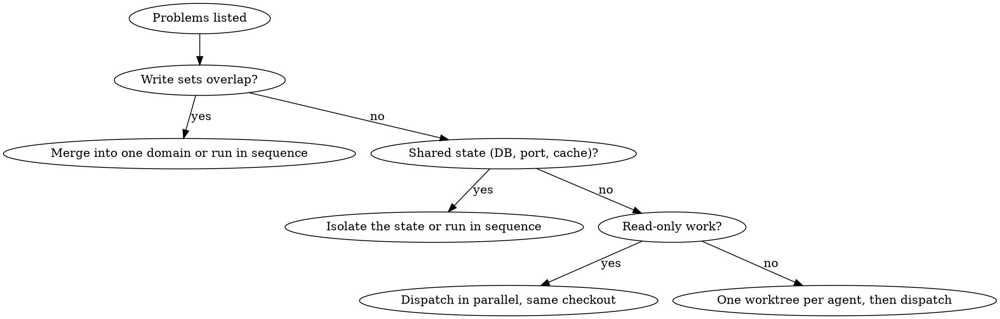

# Parallel Execution

When several problems are genuinely independent, working them one after another wastes wall-clock time and fills one context with unrelated detail. Give each problem its own agent with a focused brief, let them run at the same time, and reconcile the results yourself.

**Core principle: one agent per independent problem domain, independence proven before dispatch, and a full test run after reconciliation.** Parallelism is only safe when nothing is shared; the check comes first, not after the merge conflict.

## The Prime Directive

```
NO PARALLEL DISPATCH UNTIL INDEPENDENCE IS PROVEN AND ISOLATION IS IN PLACE
```

No exceptions. No workarounds. No shortcuts.

## When to Use

**Required:**
- Two or more problems, each understandable without the others' context.
- No shared files, no shared mutable state (database, ports, caches, generated files), no ordering between them.
- Examples: three test files failing for different reasons in different subsystems; researching three unrelated libraries; two modules with disjoint file sets.

**Skip:**
- The failures may share a cause (fixing one may fix the others): investigate together first with `godmode:fault-diagnosis`.
- You do not yet know what is broken: explore before splitting.
- The work is a sequential plan: use `godmode:delegated-execution` or `godmode:inline-execution`.
- Workers must exchange findings mid-work: use `godmode:team-orchestration`.
- Only one problem, or two tiny ones: do them yourself; dispatch overhead exceeds the gain.

## The Protocol

1. **Enumerate the problems.** One line each: what is broken or wanted, and the evidence (failing test names, error text, the request).

2. **Map each to its domain.** For every problem, list the files it will likely read and write, the commands it will run, and any state it touches (test database, port, cache directory, lockfile, generated code).

3. **Prove independence.** Build a small table: rows are problems, columns are write sets and shared resources. Any overlap in written files or touched state means those problems are not independent; merge them into one domain or run them in sequence. Write the table down; it is the evidence for the decision.



4. **Put isolation in place.** Read-only investigations can share the checkout. Any agent that writes gets its own worktree (`godmode:workspace-isolation`, or the harness's built-in per-subagent worktree option where it has one) so that a mistaken edit outside the expected files cannot clobber another agent's work. Confirm each worktree exists and its baseline is known before dispatch.

5. **Write one brief per agent** using `godmode:agent-briefing`. Each brief names: the single problem; the evidence (error text, test names, verbatim); the files in scope and the files out of scope; constraints ("do not change production code", "do not raise timeouts"); the exact verification command; the report-file path; and "do not dispatch subagents". Choose each agent's model and effort per `godmode:model-routing` and name both on the dispatch.

6. **Dispatch all of them in the same turn,** so they run concurrently. One per turn is sequential execution with extra overhead.

7. **Wait without burning context.** Do local work while they run. When idle, wait in bounded stretches; between stretches, check for agents that finished without reporting.

8. **Read the short replies, then the report files** only where a reply raises a concern. Each report says: root cause, what changed, files, verification command and output.

9. **Reconcile.** For each agent:
   - Check its diff touches only the files its brief allowed. Anything outside is a finding.
   - Check no two diffs touch the same file or the same interface. If they do, resolve it by hand and say so.
   - Spot-check one change per agent against its stated root cause. Agents make systematic errors (a timeout raised instead of a race fixed).
   - Merge the worktree branches into the working branch one at a time, running that agent's verification after each merge.

10. **Run the full suite** on the integrated result, not the per-agent subsets. Green per agent proves nothing about the combination. Read the output.

11. **Report** to the user: per problem, the root cause and the fix; the reconciliation (conflicts found, how resolved); the full-suite result with counts. Then hand off to `godmode:code-review` or `godmode:merge-protocol` as the work requires.

## Brief Skeleton

```
Role: You are fixing one problem in [repo], in [worktree path].
Problem: [one sentence]
Evidence: [failing test names and error text, verbatim]
In scope: [files you may change]
Out of scope: [everything else; do not change]
Constraints: [for example: find the real cause; do not raise timeouts; do not edit tests to pass]
Verify with: [exact command]; it must pass and its output must be clean.
Do not dispatch subagents.
Report: write root cause, changes, files, the command and its output to [REPORT_FILE];
reply with status (DONE | BLOCKED | NEEDS_CONTEXT), commits, one-line test result, concerns.
```

## Cognitive Traps

| Rationalisation | Truth |
|---|---|
| "These look unrelated, no need to map write sets" | "Looks unrelated" is how two agents end up editing the same config file. The table takes two minutes. |
| "They're all small, one shared checkout is fine" | One stray edit in a shared checkout corrupts another agent's work silently. Writers get worktrees. |
| "Each agent's tests passed, so we're done" | Per-agent green says nothing about the combination. Run the full suite after integration. |
| "Six agents finish faster than three" | More agents means more reconciliation and more tokens. Split by real domains, not by count. |
| "I'll paste the whole context so they don't miss anything" | Bloated briefs lose focus and cost tokens in every agent. Give each agent its problem, its files, its evidence. |
| "The summaries say it's fixed" | Summaries are claims. Spot-check each change against its root cause. |

## Guardrails

**Never:**
- Dispatch parallel writers into one checkout.
- Split problems that may share a root cause before investigating them together.
- Let an agent's brief leave its file scope open ("fix whatever is needed").
- Integrate without reading each diff's file list.
- Report success without a full-suite run on the integrated result.

**Always:**
- Write the independence table before dispatching.
- Name model and effort on every dispatch.
- Dispatch all independent agents in one turn.
- Merge agent branches one at a time with verification between merges.
- Tell the user about every conflict you resolved by hand.

## Connections

- `godmode:agent-briefing`: the brief and report formats each agent uses.
- `godmode:workspace-isolation`: one worktree per writing agent.
- `godmode:model-routing`: tier and effort per agent.
- `godmode:fault-diagnosis`: when failures may share a cause, before deciding to split.
- `godmode:team-orchestration`: when the agents turn out to need each other's findings mid-work.
- `godmode:completion-gate`: evidence before the "all fixed" claim.
- `godmode:merge-protocol`: landing the integrated result.
