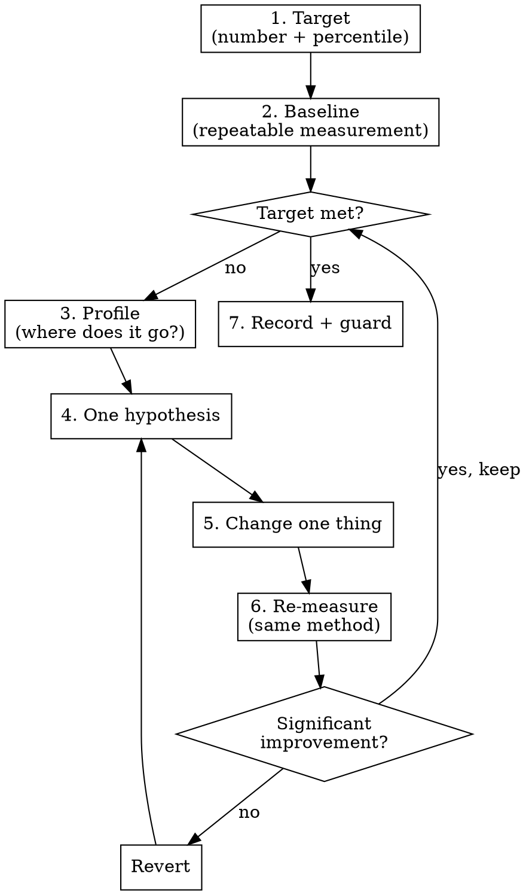

# Performance Tuning

Intuition about where time goes is wrong more often than it is right. You measure the problem, profile to find where the time or memory actually goes, change one thing, and measure again with the same method. **No measurement, no optimisation: every change is justified by a number before and proven by a number after.**

## The Prime Directive

```
NO OPTIMISATION WITHOUT A MEASUREMENT PROVING THE PROBLEM
```

No exceptions. No workarounds. No shortcuts.

## When to Use

**Required:**
- A user, test or monitor reports slowness, timeouts, high memory, large bundles or high cost.
- A performance budget or target is breached (latency percentile, Core Web Vitals, bundle size, query time, cold start).
- Someone asks to "optimise", "speed up" or "make it scale".
- You are about to add a cache, an index, concurrency, a rewrite in another language or a micro-optimisation.

**Skip:**
- The code does not work correctly yet. Correctness comes first; invoke `godmode:fault-diagnosis` or `godmode:test-first`.
- There is no target and no complaint. "It might be slow some day" is not a problem; record it and move on.
- Choosing a sensible algorithm or data structure while first writing code. That is ordinary design, not tuning, as long as it does not cost clarity.

## The Protocol



1. **Set the target.** A number, a percentile and a context: "p95 under 300 ms for `GET /orders` at 50 requests per second", "LCP 2.5 s or less at the 75th percentile on mobile", "bundle under 200 KB gzipped". Without a target there is no end condition; ask the user for one or propose one.

2. **Take a baseline that you can repeat.** Same input data, same environment (production-like, not a debug build), warm-up runs discarded, several runs, and the spread reported, not one number. Save the exact command and its output. Tools are in the table below.

3. **Profile before you guess.** Use a profiler, query plan, trace or bundle analyser to find where the time, memory or bytes go. The evidence is a profile artefact (flame graph, `EXPLAIN ANALYZE` output, trace) that names the hot spot. Usual suspects, in rough order: database queries (N+1, missing index, full scans), network round trips made in sequence, serialisation of oversized payloads, algorithmic complexity, synchronous I/O, and memory churn.

4. **State one hypothesis** that links the hot spot to a change: "The order list makes one query per item (N+1); a single joined query should cut p95 from 920 ms to under 300 ms."

5. **Change one thing.** One change per measurement, behind passing tests, so the effect is attributable. Keep the change on its own commit.

6. **Re-measure with the identical method** and compare against the baseline, including the spread. If the improvement is within the noise or misses the expectation, revert it, even if it "should" help. If it helps, go back to step 2 with the new baseline until the target is met.

7. **Record and guard.** Write the before and after numbers, the method and the commit in the PR description. Add a guard so the regression cannot return silently: a benchmark in CI, a budget check (`godmode:quality-gates`), or a test that asserts the query count.

## Measurement Tools

<!-- Commands checked 2026-10-25 against: https://github.com/sharkdp/hyperfine ; https://github.com/benfred/py-spy ; https://nodejs.org/api/cli.html ; https://pkg.go.dev/cmd/go ; https://www.postgresql.org/docs/current/sql-explain.html ; https://github.com/GoogleChrome/lighthouse -->

| What | Measure | Profile |
|---|---|---|
| A command or script end to end | `hyperfine --warmup 3 'cmd'` (compare two: `hyperfine 'old' 'new'`) | the language profiler below |
| Python | `pytest-benchmark`, `timeit` | `py-spy record -o profile.svg -- python app.py`, `py-spy top --pid <pid>` |
| Node.js | `hyperfine`, a benchmark library | `node --cpu-prof app.js` (CPU), `node --heap-prof app.js` (memory); open the files in browser DevTools |
| Go | `go test -bench . -benchmem` | `go test -bench . -cpuprofile cpu.out`, then `go tool pprof cpu.out` |
| Rust | a benchmark harness such as Criterion | `perf` or a flame-graph tool on Linux |
| PostgreSQL query | `EXPLAIN (ANALYZE, BUFFERS) <query>` | the same plan: look for sequential scans, row-estimate errors, loops |
| HTTP service under load | a load generator at a fixed request rate, reporting percentiles | APM traces or the language profiler on the server |
| Web page | `lighthouse <url>` (lab), field data from real users for Core Web Vitals | browser DevTools Performance panel |
| Bundle size | the bundler's analyser or a size-limit check | the same analyser, per module |

`EXPLAIN ANALYZE` executes the statement. For `INSERT`, `UPDATE` or `DELETE`, run it inside a transaction and roll back.

## Budgets

<!-- Core Web Vitals thresholds from https://web.dev/articles/vitals , fetched 2026-10-25 -->

A budget turns "fast enough" into a check. Set budgets where the user feels the result, and enforce them in CI.

| Kind | Example budget | Source of the number |
|---|---|---|
| Largest Contentful Paint | 2.5 s or less | Core Web Vitals "good", 75th percentile of page loads, mobile and desktop separately |
| Interaction to Next Paint | 200 ms or less | Core Web Vitals "good", 75th percentile |
| Cumulative Layout Shift | 0.1 or less | Core Web Vitals "good", 75th percentile |
| API latency | p95 and p99 per endpoint at expected load | the product's requirement or service-level objective |
| Query time | per query on production-sized data | the endpoint budget minus everything else |
| Bundle or binary size | per entry point, gzipped | what the target devices and networks tolerate |
| Memory | peak resident memory per process | the container or device limit with headroom |

Report percentiles, not averages: an average hides the slow requests users complain about.

## Anti-Patterns

| Anti-pattern | Why it fails | Instead |
|---|---|---|
| Caching first | Adds staleness, invalidation bugs and memory; hides the slow code | Fix the slow query or call; cache only with a measured need and an invalidation plan |
| Index everything | Indexes slow writes and use storage | Add the index the query plan asks for, and confirm with a new plan |
| Async or parallel everything | No gain for CPU-bound work, harder debugging, new races | Use concurrency for independent I/O that the profile shows waiting |
| Micro-optimising a loop the profiler did not flag | Saves nanoseconds, costs clarity | Only touch code on the hot path |
| Several changes at once | You cannot tell which helped, or which hurt | One change per measurement |
| Benchmarking a debug build or tiny data | Numbers do not transfer to production | Production-like build, data volume and hardware |
| One run, no spread | Noise looks like improvement | Several runs with warm-up; compare spreads |
| Rewriting in a faster language | Months of risk for a hot spot that is usually one query | Profile; fix the hot spot first |

## Cognitive Traps

| Rationalisation | Truth |
|---|---|
| "I know where the bottleneck is." | Profilers exist because that belief is wrong so often. Show the profile. |
| "This will be slow at scale." | Then measure at that scale with a load test. Until then it is a guess. |
| "Caching will make everything faster." | Caching makes cache hits faster and everything else more complicated. Measure what is slow first. |
| "Best practice says to add an index here." | Best practice does not know your queries. The query plan does. |
| "While I'm in here, I'll tune this too." | Unmeasured, unplanned changes are noise in the next measurement. One change at a time. |
| "It feels faster." | Feelings are not a measurement. Run the same benchmark. |
| "The improvement is small but it can't hurt." | Every change costs clarity and review time. Changes within the noise are reverted. |

## Guardrails

**Never:**
- Optimise without a target, a baseline and a profile.
- Change more than one thing between measurements.
- Keep a change whose effect is within the measurement noise.
- Trade correctness, security or readability for an unmeasured gain.
- Report averages alone, or a single run, as evidence.

**Always:**
- Save the exact measurement command and its output, before and after.
- Measure in a production-like build and environment.
- Keep tests green across every optimisation step.
- Add a regression guard (benchmark, budget or query-count test) for every win you keep.

## Connections

- `godmode:fault-diagnosis`: when slowness is really a bug (a hang, a leak, a retry storm), diagnose it there.
- `godmode:system-design`: when the profile points at architecture (data model, service boundaries, hosting), the decision moves there.
- `godmode:quality-gates`: budgets and benchmarks become CI gates.
- `godmode:test-first`: tests pin behaviour before the optimisation changes code.
- `godmode:grounding`: profiler flags and framework performance features are checked against current documentation.
- `godmode:completion-gate`: the before and after numbers are the evidence that the work is done.
