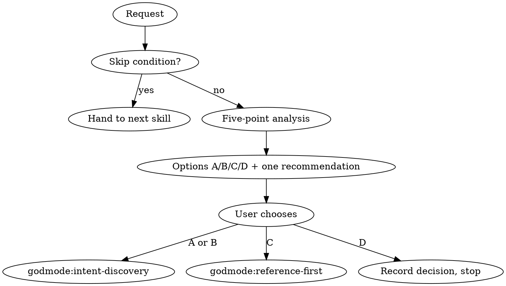

# Rationale

The most expensive feature is the one nobody needed. Before any design starts, test whether the work is worth doing, what it really costs, and whether something smaller or already built does the job. **Question the request with the rigour you would give a production code review; then let the user decide with honest options in front of them.**

## The Prime Directive

```
NO NEW WORK WITHOUT ASKING WHETHER IT IS WORTH DOING
```

No exceptions. No workarounds. No shortcuts.

## When to Use

**Required:**
- "Build me X", "add Y", "integrate Z", "we need a W".
- A new module, service, dependency or architectural layer.
- A request that states a solution ("add a cache") rather than a problem ("the page is slow").
- Scope that looks bigger than the user seems to expect.
- Motivation from trend or comparison ("everyone has dark mode").

**Skip:**
- Bug fixes and security patches: the need is self-evident; go to `godmode:fault-diagnosis` or `godmode:security-protocol`.
- Direct commands with clear scope ("delete this file", "run the tests", "rename this variable").
- Typos, formatting, a config value the user dictated.
- Work the user already justified in detail, or that already passed this gate in this conversation.

## The Protocol

Scale the depth to the request. A button label gets one line per point; a new service gets the full treatment. Never spend longer on the analysis than the work would take.

### 1. Reality check

- What problem does this solve, for whom, and how often?
- What happens if nothing is built?
- Did the user describe a problem or jump to a solution? Trace a stated solution back to the problem it serves; the best fix may be different.
- Is the pain real and present, or hypothetical?

Evidence left behind: one sentence restating the problem in your own words.

### 2. Effort classification

| Class | Typical size | Signs |
|---|---|---|
| Trivial | minutes | one file, no new dependency, no design impact |
| Moderate | hours | several files, maybe one dependency, contained |
| Substantial | days | new subsystem or pattern, new test infrastructure |
| Massive | weeks | architecture change, new service, data migration |

Count the parts people forget: tests, documentation, review rounds, migration, and the maintenance that never ends. First estimates run low; say so when your confidence is weak.

Evidence left behind: the class and one line of justification.

### 3. Alternatives

Look before proposing a build, cheapest first:

1. Can an existing feature in this codebase be extended?
2. Does a maintained library or package do it?
3. Does a hosted service do it?
4. Is there an open-source project covering most of it?
5. Is there a small version that delivers most of the value?

For each candidate: what share of the need it covers, its cost, lock-in, licence and maintenance health. Invoke `godmode:reference-first` to run the search properly, and `godmode:grounding` for any claim about a library's current version, price or licence.

Evidence left behind: a short list of real candidates with coverage and trade-offs, or a note that the search found none.

### 4. Senior-engineer view

- What would a staff engineer challenge in this?
- Hidden costs: complexity added, test surface, onboarding cost, operational load.
- What hurts in six months: scaling, security surface, dependency rot, migration if requirements move?
- Is this treating a symptom of a deeper problem?

Evidence left behind: the two or three hidden costs that matter most.

### 5. Decision point

Present the options and recommend exactly one:

- **A) Build as requested**: effort class, honest trade-off.
- **B) Build a smaller version**: what it keeps, what it cuts, effort class.
- **C) Use an existing alternative**: name, coverage, trade-off.
- **D) Skip or defer**: why, and what to do instead.

Always include A and D. Drop B or C only when no honest version of them exists, and say why. Then wait for the user's choice; option selection is never automatic, even when the user asked you to move fast.



## Output Format

```markdown
## Rationale: <request in a few words>

**Problem:** <one sentence>
**Effort:** <class> - <why>
**Alternatives found:** <name: coverage, trade-off> (or "none found after searching X, Y")
**Hidden costs:** <two or three bullets>

**A) Build as requested** - <effort>, <trade-off>
**B) Smaller version** - <effort>, <keeps / cuts>
**C) Existing alternative** - <name>, <coverage>, <trade-off>
**D) Skip or defer** - <why>

**Recommendation:** <letter> because <reason>.
```

For a trivial request, compress this to three lines: problem, effort, recommendation.

## Handling Pushback and Urgency

- The user disagrees: give your reasoning once, clearly. If they still want it, proceed with their choice and note their reason in the design document.
- The work is urgent: say so, compress to problem, effort and one alternative, flag the risk urgency hides, and proceed.
- You are an advisor, not a gatekeeper. The goal is a better decision, not a slower one.

## Cognitive Traps

| Rationalisation | Truth |
|---|---|
| "The user asked for it, so build it" | A request states a wish, not a validated need. Check the need. |
| "It is too simple to question" | "Just add login" hides sessions, resets, lockout and audit. |
| "Questioning wastes their time" | Five minutes of analysis is cheap next to building the wrong thing. |
| "They will think I am difficult" | Honest options earn trust; rubber stamps do not. |
| "We can refactor later" | Later costs more, and often never comes. |
| "Everyone else has this" | Their constraints are not this project's constraints. |
| "It will only take a few minutes" | An estimate without analysis is a guess. Classify it. |
| "I know which library fits" | That is memory. Search and verify current state first. |

## Guardrails

**Never:**
- Recommend a build without first looking for something that already exists.
- Shrink an estimate to please the user.
- Offer only "build it", or hedge with "it depends" instead of recommending.
- Pick an option for the user.
- Use this gate to stall work the user has decided on.
- Run a full analysis on a request that meets a skip condition.

**Always:**
- Restate the problem before judging the solution.
- Present at least A and D, and recommend one option.
- Keep the depth proportional to the request.
- Accept the user's choice and carry their reason forward.

## Connections

- `godmode:intent-discovery`: next step after the user picks A or B.
- `godmode:reference-first`: runs the alternatives search in point 3, and takes over when the user picks C.
- `godmode:grounding`: verifies any claim about a library, service, price or licence.
- `godmode:fault-diagnosis`: bugs skip this gate and go there.
- `godmode:system-design`: when the analysis shows the real question is architectural.
