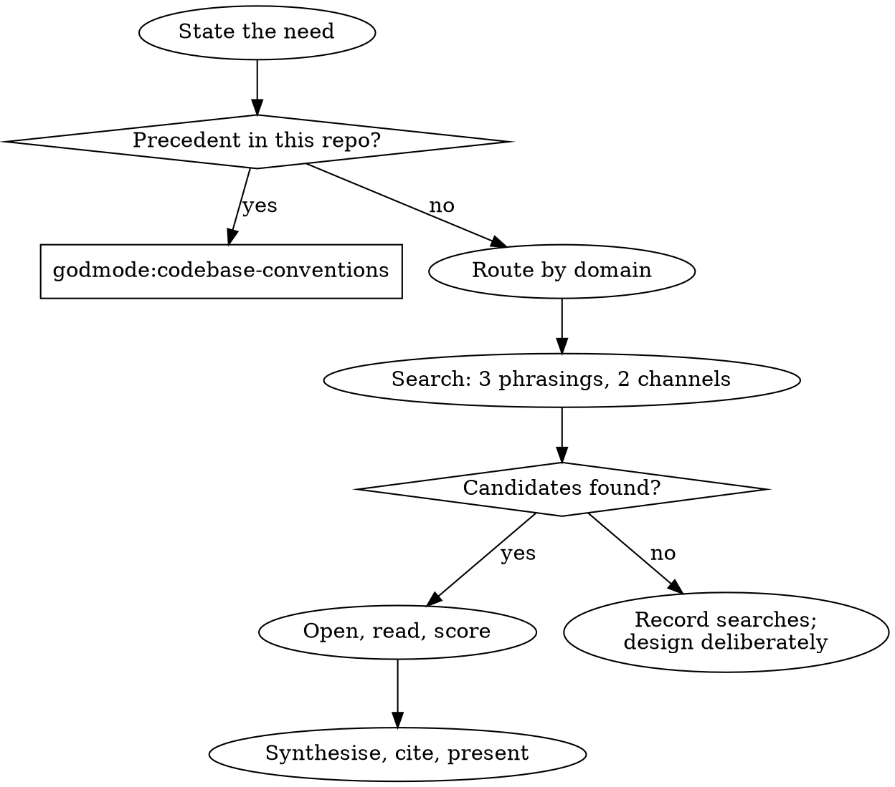

# Reference First

Most things you are asked to build have been built before by teams who spent months on them and fixed the incidents that followed. This skill routes each task to the right kind of reference, finds two or three good ones, and turns them into a short, cited blueprint before any code is written. **Build on a named, inspected reference, never on what seems plausible.**

## The Prime Directive

```
NO DESIGN WITHOUT A NAMED, INSPECTED REFERENCE
```

No exceptions. No workarounds. No shortcuts.

A reference you remember is not a reference. A reference counts once you have opened it in this session, read the part you are borrowing, and can link to it.

## When to Use

**Required:**
- Designing a public or internal API, webhook, event format or error model.
- Designing a database schema for a domain with known shapes (users and roles, bookings, orders, billing, content, messaging).
- Choosing a test strategy or setting up CI/CD for a project.
- Making an architecture or module-boundary decision.
- Building a feature that plausibly exists as a library, starter or open-source project (auth, uploads, search, queues, payments, editors, games).
- Picking between several libraries for the same job.

**Skip:**
- Adding code inside an existing codebase that already has a precedent for it. The precedent is the reference: invoke `godmode:codebase-conventions` instead.
- One-line fixes, renames, and changes whose shape the user has fully specified.
- The user has named the reference ("do it the way Stripe does pagination"). Open that reference and use it; skip the search.

## Route First

Classify the task, then send it where the references live. One task can touch more than one row.

| The task is about | Route to |
|---|---|
| Code inside an existing repository | `godmode:codebase-conventions` (internal precedent beats external reference) |
| Any screen, page, component or visual design | `godmode:ui-research`, then `godmode:ui-engineering` |
| Architecture, hosting, databases, queues, auth strategy | `godmode:system-design`, with the [architecture references](references/architecture-references.md) |
| API, webhook, error format, schema | this skill, [API and schema references](references/api-and-schema-references.md) |
| Test strategy, CI/CD, release pipeline | this skill, [testing and CI references](references/testing-and-ci-references.md) |
| A library, starter or open-source implementation | this skill, [GitHub and registry search](references/github-search.md) |
| A fact that can change (an API's current behaviour, a flag, a version, a limit) | `godmode:grounding` before you rely on it |

The libraries in `references/` are starting points that were checked when they were written. They are not proof: re-open the page before you cite it, because documentation moves.

## The Protocol

1. **State the need in one sentence.** What exactly must the reference answer? "How should list endpoints paginate" is a need; "API design" is not. Write it down; it keeps the search narrow.

2. **Check the internal precedent first.** If the repository already does this somewhere, that wins over any external reference unless the user agrees to change it. Hand off to `godmode:codebase-conventions` and stop here if a precedent exists.

3. **Pick the reference class.** Use the route table. Within a class, prefer in this order: a published standard or RFC, the official documentation of a product known for the pattern, a mature open-source implementation, a curated list, a blog post. Lower rungs need more corroboration.

4. **Find candidates.** Search with at least three different phrasings across at least two channels (the reference library, GitHub search, a package registry, a web search). The method and query templates are in [github-search.md](references/github-search.md). Stop at three to five serious candidates.

5. **Inspect, do not skim.** For each candidate, open the actual page, file or schema and read the part you intend to borrow. Record the URL, what it shows, the licence (for code), when it was last updated, and why it is credible. Drop any candidate you cannot open.

6. **Score the candidates** against the quality criteria below. Discard anything that fails a hard gate.

7. **Synthesise.** Take each concern from the reference that handles it best, and say which reference each decision came from. Resolve conflicts between references explicitly; do not average them. Mark what is genuinely new to this project.

8. **Present and confirm.** Show the user the blueprint before building when the choice is consequential (a public API shape, a schema, an architecture, a new dependency). Use the format below. Wait for a choice when the options differ materially; proceed when there is one clear winner and the user has already approved the direction.

9. **Record the sources.** Put the reference URLs in the design document or plan, next to the decision they justify, and in code comments where a non-obvious pattern was borrowed. A later reader must be able to follow the link and see why.



## Reference Quality Criteria

| Criterion | Strong signal | Weak signal |
|---|---|---|
| Authority | Standard, RFC, or the vendor's own documentation | Unsourced blog post, AI-generated summary |
| Production use | Run by real organisations at the scale you need | Demo or tutorial code |
| Maintenance | Commits or doc updates in the last year | Archived, or untouched for years |
| Fit | Solves your stated need directly | Adjacent problem, needs heavy adaptation |
| Clarity | The pattern can be explained in a paragraph | You cannot tell which part does the work |
| Licence (code) | OSI licence compatible with the project | No licence file, or copyleft you cannot honour |
| Evidence | Tests, changelog, documented trade-offs | No tests, no docs |

**Hard gates:** you opened it this session; it does what you need; for copied code, the licence allows it.

## Licence Compatibility

Ideas and patterns can be studied freely; code is covered by its licence. Before any code moves from a reference into the project:

1. Read the reference's `LICENSE` file, not only the badge or the registry metadata (registries often say `NOASSERTION` or "see licence file").
2. Check compatibility with the project's licence using the table in [github-search.md](references/github-search.md).
3. No licence means default copyright: study it, do not copy it. <!-- https://docs.github.com/en/repositories/managing-your-repositorys-settings-and-features/customizing-your-repository/licensing-a-repository -->
4. Keep required notices (an Apache-2.0 `NOTICE` file, MIT copyright lines) with the copied code.
5. When unsure, re-implement the pattern from its description rather than copying, and tell the user.

## Presenting the Blueprint

```
Need: <one sentence>

References inspected:
A) <name> - <url> - <licence if code> - <why credible>
   Borrow: <the specific pattern>
B) <name> - <url> - ...
   Borrow: <...>

Blueprint (recommended):
- <decision 1> (from A)
- <decision 2> (from B; A does X instead, rejected because ...)
- <decision 3> (new to this project; no reference covers it)

Searched and rejected: <what, and why>
```

When no reference fits after a real search, say so plainly: list the queries and channels, design deliberately, and mark the result as unreferenced so reviewers look harder at it.

## Cognitive Traps

| Rationalisation | Truth |
|---|---|
| "I know how Stripe does this." | You remember a version of it. Open the page; Stripe now ships a new API version every month. |
| "This is too simple to need a reference." | Simple shapes (pagination, errors, IDs) are copied into every endpoint. Mistakes there multiply. |
| "Nothing like this exists." | You searched with one phrasing. Try three, including synonyms and the problem statement. |
| "One good reference is enough." | One reference gives you its blind spots. Two or three show which choices are deliberate. |
| "The user did not ask for research." | They asked for something that works. Ten minutes of reading is cheaper than a redesign. |
| "It is open source, so I can copy it." | Open source has licences. No licence means no permission. |
| "I will look for references if I get stuck." | By then the structure is set. References matter most before the first decision. |
| "The reference is old, so it is wrong." | Age is a prompt to check, not a verdict. Standards from years ago still hold. |

## Guardrails

**Never:**
- Cite a reference you did not open in this session.
- Copy code from a repository without reading its licence.
- Present a blend of references without saying which decision came from which source.
- Override an existing in-repo convention because an external reference does it differently, without the user's agreement.
- Pad the blueprint with references you did not use.

**Always:**
- Search at least three phrasings across at least two channels before concluding nothing fits.
- Record the URL next to every borrowed decision.
- Route UI work to `godmode:ui-research` and in-repo work to `godmode:codebase-conventions`.
- Verify changeable facts in a reference through `godmode:grounding` before building against them.
- Tell the user when the result is unreferenced.

## Connections

- `godmode:intent-discovery`: calls this skill during design to answer "what already exists?"; the blueprint goes into the design document.
- `godmode:grounding`: verifies the current behaviour of any API, flag or version a reference relies on.
- `godmode:codebase-conventions`: takes over when the repository already has a precedent.
- `godmode:ui-research` and `godmode:ui-engineering`: take over for interfaces.
- `godmode:system-design`: takes over for architecture, hosting and data-store choices.
- `godmode:task-planning`: plan tasks cite the references chosen here.
- `godmode:security-protocol`: reviews borrowed auth, crypto and input-handling patterns.
