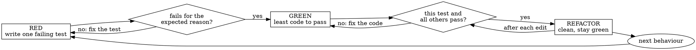

# Test-First Development

Every change in behaviour starts as a test that fails for the right reason. You write the test, run it, watch it fail, write the least code that makes it pass, and only then clean up. **A test you never saw fail is a test you have no evidence for.**

## The Prime Directive

```
NO PRODUCTION CODE WITHOUT A FAILING TEST THAT YOU WATCHED FAIL
```

No exceptions. No workarounds. No shortcuts.

Production code written before its test is deleted, not kept "for reference" and not adapted while the test is written. Delete it and build it again from the test.

## When to Use

**Required:**
- A new feature, function, endpoint, command or component.
- A bug fix: the failing test reproduces the bug before the fix exists.
- A refactor: the tests that pin current behaviour run green before you touch the code, and after every step.
- Any change in behaviour, however small it looks.

**Skip (only with the user's agreement, stated in the conversation):**
- A throwaway spike whose code will be discarded. When the spike ends, delete it and start the real work test-first.
- Generated code (lockfiles, generated clients, migrations produced by a tool) where the generator is the thing under test.
- Pure configuration with no logic. Configuration that changes behaviour is verified by `godmode:completion-gate` instead.

## The Protocol



1. **Name the behaviour.** Write one sentence: "When X, the code does Y." If you cannot write it, you do not yet know what to build; go back to the plan or ask the user one question.

2. **Name the break.** Before writing the test body, name the production mistake that would make this test fail (a wrong branch, a missing side effect, an off-by-one, an unhandled error). A test that no realistic bug can fail is not worth writing.

3. **RED: write one test.** One behaviour per test, a name that reads as the behaviour, real code wherever possible. Derive the expected value by hand (a literal or a hand-checked fixture), never by calling the code under test.

4. **Watch it fail.** Run only that test (`npm test -- path/to/file`, `pytest path::test_name`, `go test -run Name ./pkg`). Read the output and confirm three things:
   - it fails, rather than erroring on a typo, a missing import or a broken fixture;
   - the failure message is the one you predicted;
   - it fails because the behaviour is missing, not for an unrelated reason.

   If it passes, you are testing behaviour that already exists, or the test cannot fail; rewrite it. If it errors, fix the error and run it again until it fails cleanly. Keep the failing output: it is the evidence for this step.

5. **GREEN: write the least code that passes.** Hard-code if that is the least code; the next test will force the generalisation. No options, parameters or abstractions the tests do not demand. No "while I am here" edits elsewhere.

6. **Watch it pass.** Run the test, then the whole suite. The new test passes, every other test still passes, and the output carries no new warnings. If the new test fails, fix the code, not the test. If another test broke, fix that now, before anything else.

7. **REFACTOR.** Only on green. Remove duplication, improve names, extract helpers. Run the suite after every edit. Refactoring adds no behaviour; a new behaviour needs a new failing test.

8. **Repeat** from step 1 for the next behaviour. Commit at green points so every commit has passing tests. For a bug fix, commit the reproducing test on its own first (`test: reproduce <bug>`), then the fix (`fix: ...`): the red evidence then survives in history, and a reviewer can check out the first commit and watch it fail.

## Bug Fixes

A bug report is a test you have not written yet.

1. Write a test that reproduces the reported symptom through the same entry point the user hit.
2. Watch it fail with the symptom the user described. If it passes, your reproduction is wrong; keep working on the test, not the fix.
3. Find the root cause with `godmode:fault-diagnosis` before you change production code.
4. Fix at the root cause, watch the test pass, run the suite.
5. Prove the test guards the fix: revert the fix, watch the test fail again, restore the fix, watch it pass. This red-green-red-green loop is what `godmode:completion-gate` asks for when you claim a regression test works.

## Writing Good Tests

| Quality | Good | Bad |
|---|---|---|
| One behaviour | `rejects an empty email` | `validates email and domain and whitespace` |
| Behaviour, not implementation | Asserts the returned value, the stored row, the emitted event | Asserts which private helper was called |
| Independent expectation | `expect(slug('A B')).toBe('a-b')` | `expect(slug(x)).toBe(slug(x))` |
| Real collaborators | Uses the real parser and an in-memory store | Mocks every collaborator, then asserts on the mocks |
| Deterministic | Waits for the condition it needs | Sleeps for a guessed number of milliseconds |
| Readable failure | The failure message says what was expected | `expected true, got false` |

Before adding a mock, a test helper or a cleanup method, read [the testing anti-patterns](references/testing-anti-patterns.md). It covers asserting on mocks, test-only methods on production classes, mocking without knowing the side effects, incomplete fake data, mirror assertions and change detectors.

For timing-dependent tests, replace sleeps with condition-based waiting; the method is in `godmode:fault-diagnosis`.

## Worked Example

Behaviour: "A failing operation is retried until it succeeds, at most three attempts."

RED:

```typescript
test('retries a failing operation until it succeeds, at most three attempts', async () => {
  let calls = 0;
  const flaky = async () => {
    calls++;
    if (calls < 3) throw new Error('transient');
    return 'done';
  };

  await expect(withRetry(flaky)).resolves.toBe('done');
  expect(calls).toBe(3);
});
```

Run it: `ReferenceError: withRetry is not defined`. That is an error, not a failure. Add an empty `withRetry` that returns `undefined`, run again: `expected 'done', received undefined`. That is the predicted failure.

GREEN:

```typescript
export async function withRetry<T>(fn: () => Promise<T>): Promise<T> {
  let lastError: unknown;
  for (let attempt = 1; attempt <= 3; attempt++) {
    try {
      return await fn();
    } catch (error) {
      lastError = error;
    }
  }
  throw lastError;
}
```

Run it: passes. Run the suite: passes. The next behaviour ("the error from the third attempt is rethrown") gets its own failing test before any change.

## When You Are Stuck

| Problem | What it tells you |
|---|---|
| You cannot think how to test it | Write the call you wish existed and the assertion first; the API falls out of that. |
| The test needs a page of setup | The design is too coupled. Extract the logic so it can be called with plain inputs. |
| You must mock everything | The unit does too much or reaches for its dependencies. Inject them. |
| The only way to observe the result is a private field | Test through the public behaviour that depends on that field. |
| The codebase has no tests at all | Start with a characterisation test of the current behaviour of the code you are about to change. |

## Cognitive Traps

| Rationalisation | Truth |
|---|---|
| "It is too simple to need a test." | Simple code breaks too, and the test takes a minute. Simple tests are the cheapest ones you will ever write. |
| "I will write the tests afterwards." | Tests written after the code pass on the first run, so they prove nothing about themselves. You test what you built, not what was needed. |
| "I already tried it by hand." | A manual check leaves no record and cannot be rerun on the next change. |
| "I will keep the code I wrote as a reference while I write the test." | You will copy it, and the test will be shaped to fit it. That is testing afterwards with extra steps. Delete it. |
| "Deleting two hours of work is wasteful." | The hours are spent either way. What you choose now is between code you can trust and code you hope works. |
| "The test passed straight away, so the code is right." | A test that passes before the code exists is testing nothing. Make it fail first. |
| "This is hard to test, so testing is the wrong tool here." | Hard to test means hard to use. Change the design until it is easy. |
| "Test-first is dogma; I am being pragmatic." | Debugging an untested change in production is the least pragmatic way to spend an afternoon. |

## Guardrails

**Never:**
- Write production code before a failing test for it exists.
- Keep, adapt or glance at code written before its test.
- Change a test to make it pass when the code is wrong.
- Claim a test is red or green without having run it in this session.
- Bundle a refactor or an unrelated fix into a green step.
- Leave the suite red at a commit.

**Always:**
- Run the new test alone and read its failure before writing code.
- Derive expected values independently of the code under test.
- Run the whole suite after every green step and every refactor edit.
- Reproduce a bug as a failing test before fixing it.
- Report the red output and the green output as evidence when the work is handed on.

## Connections

- `godmode:fault-diagnosis`: a bug fix finds its root cause there before the green step; it also holds the condition-based waiting method for timing tests.
- `godmode:completion-gate`: before you say a feature or fix is done, it checks the red-green evidence and the full-suite run.
- `godmode:quality-gates`: coverage, lint and type checks run on top of the tests; they never replace them.
- `godmode:code-review`: the reviewer checks that tests assert real behaviour and that every behaviour in the spec has a test.
- `godmode:delegated-execution` and `godmode:inline-execution`: every implementation task in a plan runs this cycle; implementers report their red and green output.
