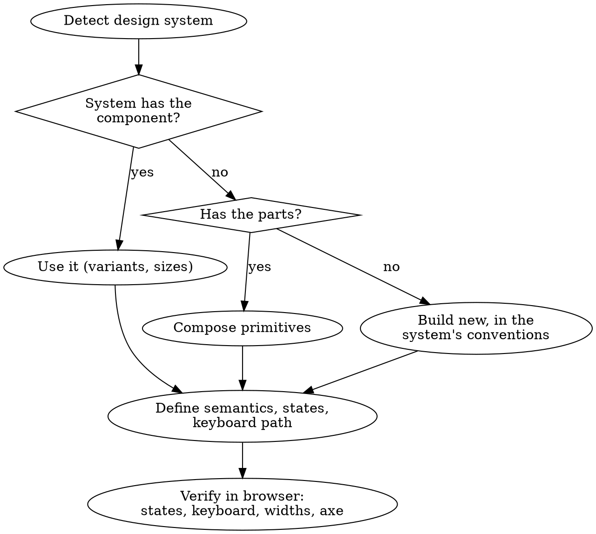

# UI Engineering

`godmode:ui-research` decides what to build: the layout reference, the tokens, the pattern and states of each component. This skill builds it inside the project's design system with sound structure: semantic markup, composed components, clear state ownership, every state implemented, accessible by keyboard and screen reader, and fast. **Use what the design system provides, define structure, states and accessibility before markup, and prove the result in a real browser.**

## The Prime Directive

```
NEVER REBUILD WHAT THE DESIGN SYSTEM PROVIDES; NEVER SHIP A COMPONENT WITHOUT ITS STATES AND KEYBOARD PATH
```

No exceptions. No workarounds. No shortcuts.

## When to Use

**Required:**
- Building or changing any component, page, layout or form.
- Adding UI to a project that has a component library, a `components/ui` directory, a theme file or token file.
- Deciding where state lives, how a layout responds, or how something animates.
- Bootstrapping the UI layer of a new project.

**Skip:**
- Pure styling copy edits that change no structure or state.
- Non-visual code (APIs, jobs) with no interface change.

Run `godmode:ui-research` first when the screen or component has no settled pattern or tokens.

## The Protocol

1. **Detect the design system.** Check the dependency manifest, then configuration files, then the source tree, using the detection table in [design-systems.md](references/design-systems.md). Record what you find: library and version, primitive layer, styling method, token location, component directory.

2. **Read its current docs for the component you need.** Library APIs change between major versions (Chakra UI v3 replaced its theming API; shadcn/ui now generates components on Radix, Base UI or React Aria). Verify the API through `godmode:grounding` before writing against it.

3. **Use, compose, or extend, in that order.**
   - The system has the component: use it with its own variant and size props.
   - It has the parts: compose them.
   - It has neither: build a new component that follows the system's conventions (naming, variant API, styling mechanism, token references, accessibility behaviour), in the system's component directory.
   - Never wrap a system component just to override its styles; use the documented extension point (theme overrides, variants, recipes, Styles API).

4. **Define before markup.** For the component, write down: the semantic element, the props surface, every state (default, hover, focus-visible, active, disabled, loading, empty, error, partial, success as relevant), variants and sizes, the responsive behaviour, and the keyboard and screen-reader behaviour (APG pattern for widgets). `godmode:ui-research` usually supplies most of this; fill any gaps.

5. **Write the test first where behaviour exists.** Interaction, validation and state transitions get a failing test through the DOM before the implementation (`godmode:test-first`). Query by role and accessible name; that doubles as an accessibility check.

6. **Build** with the rules below: composition, layout, state ownership, responsive, forms, motion, performance.

7. **Verify in a real browser.** Run the app, open the screen, and check: every state renders (force empty, loading and error), keyboard-only use works, focus is visible and never hidden, layout holds at a small and a large width, and an automated accessibility scan (for example axe) reports no violations. Take screenshots when a reviewer will need them. Report what you saw, not what you expect.

8. **Conformity.** Compare with the nearest existing component (`godmode:codebase-conventions`): same file placement, naming, export style and styling mechanism.



## No Design System Yet

Choose with the user; do not install one silently. Typical fits:

| Situation | Option |
|---|---|
| React app, wants owned, editable component code | shadcn/ui on Tailwind CSS (choose the primitive base at init) |
| Wants a complete, opinionated library with many data components | Material UI or Ant Design |
| Wants a themable library with style props | Chakra UI or Mantine |
| Distinctive brand, custom look, full control | Unstyled primitives (Radix, Base UI, React Aria, Headless UI) plus tokens |
| Not React | The framework's established library; check with `godmode:reference-first` |

Then set tokens first (from `godmode:ui-research`), and create the base components (button, input, select, card, dialog, toast) before feature screens.

## Composition Over Configuration

Prefer small parts that compose over one component with dozens of props.

```
Good                              Avoid
<Dialog>                          <Dialog title=... description=...
  <DialogHeader>                    footerAlign=... showClose=...
    <DialogTitle/>                  titleSize=... variant=... size=...
    <DialogDescription/>            overlayOpacity=... />
  </DialogHeader>
  <DialogBody/>
  <DialogFooter/>
</Dialog>
```

Keep variants to a small named set (for example primary, secondary, ghost, destructive) and sizes to three or four. More detail and examples: [component-patterns.md](references/component-patterns.md).

## Layout

| Arranging | Use |
|---|---|
| Rows and columns together (page shell, dashboard grid, aligned card grid) | CSS Grid; `repeat(auto-fill, minmax(<min>, 1fr))` for self-adjusting grids |
| One axis (nav items, toolbar, input plus button) | Flexbox with `gap` |
| A component that must adapt to its container, not the viewport | Container queries (Tailwind: `@container` with `@md:` variants) <!-- https://tailwindcss.com/docs/responsive-design --> |

Space with `gap` and spacing tokens, not margins on children. Constrain reading width for text and forms.

## State Ownership

1. Start local. Lift state only when a second component needs it.
2. Server data is not client state: use the project's server-state library (for example TanStack Query or SWR) for fetching, caching and invalidation.
3. Context is for rarely changing, widely needed values (theme, current user, locale), not for high-frequency updates.
4. A global store is the last resort, for client state many distant components change.
5. Derive values instead of storing copies; keep URL-worthy state (filters, tabs, pagination) in the URL.
6. Use whatever the project already uses for each of these (`godmode:codebase-conventions`).

## Responsive

Write the small-screen layout first and add at wider breakpoints; Tailwind's breakpoints are mobile-first, so unprefixed utilities apply at every size. <!-- https://tailwindcss.com/docs/responsive-design --> Decide per component what changes (navigation collapses to a drawer, tables scroll or stack, side-by-side becomes stacked, modals become full-screen sheets) and test at the extremes, not only the middle.

## Accessibility Checklist

- [ ] Native elements first: `button` for actions, `a` for navigation, `label` for inputs, landmarks (`header`, `nav`, `main`, `footer`).
- [ ] Every interactive element is reachable by Tab, operable by keyboard, and has an accessible name.
- [ ] Focus is visible (`:focus-visible`) and never entirely hidden by sticky content (WCAG 2.2 SC 2.4.11). <!-- https://www.w3.org/WAI/WCAG22/Understanding/focus-not-obscured-minimum.html -->
- [ ] Widgets follow their APG pattern (dialog focus trap and return, tabs with arrow keys, combobox, menu button). <!-- https://www.w3.org/WAI/ARIA/apg/patterns/ -->
- [ ] Contrast: text 4.5:1, large text 3:1, component boundaries and focus indicators 3:1.
- [ ] Pointer targets at least 24 by 24 CSS pixels or adequately spaced (SC 2.5.8). <!-- https://www.w3.org/WAI/WCAG22/Understanding/target-size-minimum.html -->
- [ ] Images: meaningful ones have `alt` text; decorative ones have `alt=""`. Icon-only buttons have a label.
- [ ] Status changes (saved, error, results updated) are announced through a live region.
- [ ] Colour is never the only signal.
- [ ] Motion respects `prefers-reduced-motion`. <!-- https://developer.mozilla.org/en-US/docs/Web/CSS/@media/prefers-reduced-motion -->

## Forms

Labels above fields, never placeholder-only; group with `fieldset` and `legend`; correct input types and `autocomplete` values. Validate when the user submits, not on blur or while typing; on failure keep their answers, show an error summary at the top with focus moved to it, and an error message by each field linked with `aria-describedby`. <!-- https://design-system.service.gov.uk/patterns/validation/ --> Prevent double submission and show progress on the submit button. Use the project's form and schema libraries if it has them.

## Motion

Animate to explain a change of state (open, close, reorder, appear), not to decorate. Keep interface transitions short, use the motion tokens, never block input while animating, and provide a reduced-motion path that removes non-essential movement.

## Performance

Core Web Vitals at the 75th percentile are the target: LCP within 2.5 s, INP of 200 ms or less, CLS of 0.1 or less. <!-- https://web.dev/articles/vitals -->

- Give images and media explicit dimensions or aspect ratios; lazy-load below the fold, never the main above-the-fold image.
- Reserve space for late content (skeletons the same size as the result) to avoid layout shift.
- Split heavy, rarely used components (editors, charts, maps) and load them on demand.
- Check the bundle cost of a new dependency before adding it.
- Keep event handlers light; move heavy work off the main thread or after paint.

Measure before and after for anything performance-motivated; hand deep work to `godmode:performance-tuning`.

## Cognitive Traps

| Rationalisation | Truth |
|---|---|
| "The library's component is close, I will write my own." | Your own one lacks the library's accessibility and fixes. Use or compose it. |
| "I will just override its CSS." | Specificity wars break on the next upgrade. Use the theme or variant API. |
| "A `div` with `onClick` is fine." | It has no keyboard support, role or focus. Use `button`. |
| "I know this library's API." | Major versions rewrite APIs. Read the current docs first. |
| "States can come later." | Empty, loading and error are what real users see first. |
| "It looks right in my viewport." | Check the smallest and largest widths and keyboard-only use. |
| "Global state is simpler." | It is simpler to write and harder to reason about. Start local. |
| "The tests pass, so the UI works." | Open it in a browser and look. Rendering, focus and layout bugs hide from unit tests. |

## Guardrails

**Never:**
- Recreate a component the design system already provides.
- Hardcode colours, sizes, spacing or durations that have tokens.
- Mix a second component or styling system into a project without the user's approval.
- Use placeholder text as the only label, or colour as the only signal.
- Claim a UI works without running it and looking at it.

**Always:**
- Detect and record the design system before writing a component.
- Verify the library's current API before using it.
- Implement every specified state and the keyboard path.
- Run an automated accessibility scan and a keyboard-only pass on new screens.
- Match the nearest existing component's file, naming and styling conventions.

## Connections

- `godmode:ui-research`: supplies layout reference, tokens and component patterns before this skill builds.
- `godmode:codebase-conventions`: the nearest existing component is the precedent to shadow.
- `godmode:grounding`: verifies current library APIs and versions.
- `godmode:test-first`: behaviour tests through the DOM before implementation.
- `godmode:performance-tuning`: for measured performance problems.
- `godmode:completion-gate`: the browser check is the evidence before claiming done.
