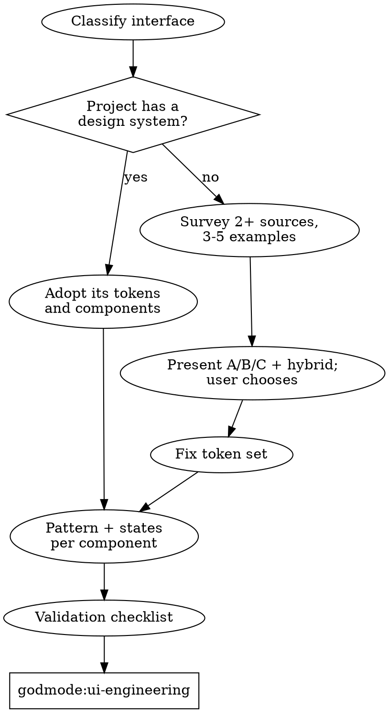

# UI Research

Interfaces generated from nothing look generated: random spacing, a palette of accidents, every section centred, no empty or error states. Professional templates and documented design systems already encode the layout, hierarchy and states that work. This skill finds those references, fixes the design tokens, and settles each component's pattern before `godmode:ui-engineering` writes any markup. **Every screen traces to a reference and every visual value traces to a token.**

## The Prime Directive

```
NO UI CODE BEFORE A PATTERN REFERENCE AND A TOKEN SET
```

No exceptions. No workarounds. No shortcuts.

Prototypes are included. Prototypes become products, and a prototype built on tokens is a five-minute restyle instead of a rewrite.

## When to Use

**Required:**
- Any new website, landing page, marketing site, portfolio or storefront.
- Any new app screen, dashboard, admin panel, settings page, onboarding flow or auth page.
- Any new component that is not already provided by the project's design system.
- Game interfaces (menus, HUD, inventories) and CLI output that a person will read.

**Skip:**
- The project has a design system and the component already exists in it: go straight to `godmode:ui-engineering` and use it.
- Pure logic changes behind an unchanged interface.
- Copy edits that do not change layout.

## The Protocol

1. **Classify the interface.** What is it (marketing page, data-dense app, e-commerce, developer tool, game, CLI), who uses it, and in what niche or industry? The class decides which pattern family and token preset apply.

2. **Check what the project already has.** Look for an installed design system, a component directory, a token file or theme (detection steps are in `godmode:ui-engineering`). If one exists, it is the reference: research patterns inside it, adopt its tokens, and skip template research.

3. **Research layouts (new sites and new apps).** Survey at least two sources from [template-marketplaces.md](references/template-marketplaces.md) in the right tier for the niche, and study three to five strong examples. For each, record the section order, navigation style, palette approach, typography and what makes it work.

4. **Extract the shared pattern.** What do all the strong examples in this niche do? Those shared elements are the niche's conventions; the differences are the design choices left to make.

5. **Present options and let the user choose.** Show three labelled options with links plus a recommended hybrid, using the format below. **Template and layout selection is always the user's call**, even when the session is otherwise autonomous: wait for the choice.

6. **Fix the tokens before any component.** Adopt the project's tokens, or start from the preset for this interface class in [design-tokens.md](references/design-tokens.md) adjusted to the chosen reference. Colours, type scale, spacing scale, radii, shadows, breakpoints, z-index and motion. Check text and UI contrast now, not after building.

7. **Settle each component's pattern.** For every component on the screen, name its pattern from [pattern-libraries.md](references/pattern-libraries.md) or the project's design system, with its required states.

8. **Run the component validation checklist** below for each new component, then hand over to `godmode:ui-engineering` with: the chosen layout reference, the token set, and the pattern and states for each component.



## Presenting Layout Options

```
I surveyed <niche> layouts on <sources>. Strongest examples:

A) <name> - <source> - <link>
   Structure: <hero type> -> <sections in order>
   Strength: <what it does best>   Palette/type: <approach>
B) ...
C) ...

D) Recommended hybrid: <section order>, taking <X from A>, <Y from B>, <Z from C>.

Shared by all strong <niche> sites: <sections and conventions>.
Which should I build: A, B, C or D?
```

Link to live demos or listing pages the user can open. Reference templates are for structure and ideas: do not copy a paid template's code or assets unless the user has bought it and its licence allows the use.

## Hallmarks of Amateur UI

| Anti-pattern | Why it looks amateur | Instead |
|---|---|---|
| Erratic spacing | Gaps vary between siblings; no rhythm | Every gap is a spacing token from one scale |
| Ad-hoc colours | Hex values chosen per component | A defined palette; components use semantic tokens |
| Type soup | Too many sizes, weights and families | One or two families, a fixed scale, a deliberate heading hierarchy |
| Flat hierarchy | Everything the same size and weight | One primary action per view; secondary elements visibly quieter |
| Everything centred | The default generated layout | Left-aligned content on a grid; centre only on purpose (hero headline, empty state) |
| Placeholder content | "Lorem ipsum", "Item 1", "User Name" | Realistic content with real lengths and edge cases |
| Happy path only | No empty, loading, error or partial states | Design all of them before building |
| Missing interaction states | No hover, focus ring or disabled look | Hover, focus-visible, active, disabled for every interactive element |
| Mixed corner radii | Sharp and rounded mixed on similar elements | One radius scale; same component, same radius |
| Decorative effects | Gradients and shadows "to make it pop" | Shadows mean elevation; motion means change of state |
| Oversized controls | Huge buttons, full-width inputs on desktop | Standard control sizes; constrained form and content widths |
| Low contrast | Grey text on grey, faint borders on controls | Meet WCAG 2.2 contrast (see checklist) |

## Component Validation Checklist

Before a component is handed to implementation, confirm each item:

- [ ] The pattern is named (design-system component or entry in the pattern library).
- [ ] Every colour, size, space, radius, shadow and duration is a token; no raw values.
- [ ] States are defined: default, hover, focus-visible, active, disabled; and, where data is involved, empty, loading, error, partial and success.
- [ ] Behaviour is specified at mobile and desktop widths at least.
- [ ] Content is realistic, including the longest and shortest plausible values.
- [ ] Text contrast is at least 4.5:1, large text at least 3:1, and UI component boundaries and states at least 3:1 against adjacent colours. <!-- https://www.w3.org/WAI/WCAG22/Understanding/contrast-minimum.html https://www.w3.org/WAI/WCAG22/Understanding/non-text-contrast.html -->
- [ ] Pointer targets are at least 24 by 24 CSS pixels or adequately spaced (WCAG 2.2 SC 2.5.8). <!-- https://www.w3.org/WAI/WCAG22/Understanding/target-size-minimum.html -->
- [ ] Keyboard path and focus order are defined; the WAI-ARIA Authoring Practices pattern is identified for widgets such as dialogs, tabs, menus and comboboxes. <!-- https://www.w3.org/WAI/ARIA/apg/patterns/ -->
- [ ] Information is never carried by colour alone.

If an item cannot be satisfied, the component is not ready to build.

## Cognitive Traps

| Rationalisation | Truth |
|---|---|
| "It is just a prototype." | Prototypes ship. Tokens cost minutes now and save a rewrite later. |
| "I will polish the styling later." | Later never comes; the hardcoded values spread first. |
| "The user gave no design requirements." | No requirements is not permission to guess. Research and offer options. |
| "Templates make everything look the same." | Synthesising several references, tuned to the brand, does not. Generated-from-nothing UI is what looks the same. |
| "I can pick the template myself to save time." | Layout direction is the user's taste and brand. Present options and wait. |
| "One hardcoded colour will not hurt." | One becomes twenty, and dark mode becomes impossible. |
| "Accessibility is a later pass." | Contrast and focus decisions live in the tokens and patterns chosen now. |
| "The happy path is enough for a demo." | The first real user sees the empty state. |

## Guardrails

**Never:**
- Write UI code before the token set and the component patterns are settled.
- Pick a template or layout direction on the user's behalf.
- Copy a paid template's code or assets the user has not licensed.
- Use placeholder text in a design you present.
- Rebuild a component the project's design system already provides.

**Always:**
- Check for an existing design system before researching anything external.
- Survey at least two sources and three examples for a new site or app.
- Present labelled options with links and a recommendation.
- Define every state for every component before implementation.
- Check contrast and target size while choosing tokens.

## Connections

- `godmode:intent-discovery`: calls this skill when the work involves an interface; the chosen layout and tokens go into the design document.
- `godmode:reference-first`: routes all interface work here.
- `godmode:ui-engineering`: receives the layout reference, token set and component patterns and builds them.
- `godmode:grounding`: verifies a design system's current API or a marketplace's current terms before relying on them.
- `godmode:performance-tuning`: when a chosen design implies heavy media or fonts, check the cost early.
